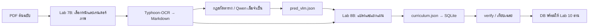
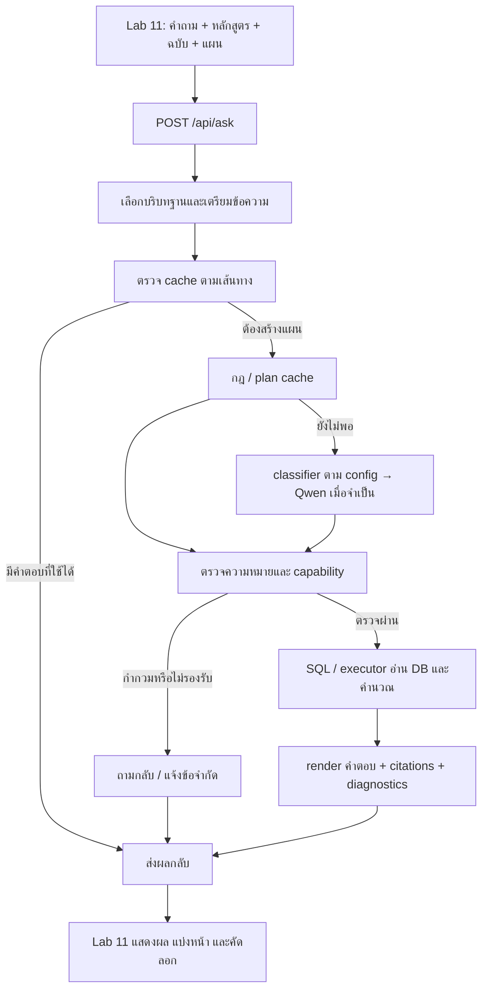

# KeRoLearn — คู่มือเริ่มใช้งานตั้งแต่ PDF ถึงเว็บถามตอบหลักสูตร

DSBA8 – LLM Course (isd-2026-KeRoLearn)
โปรเจกต์ P2: อ่านเล่มหลักสูตรด้วย OCR → สร้างฐานข้อมูล → ถามตอบภาษาไทยผ่าน Lab 10–11

**สมาชิก**

1. 67070048 (discord: orayaraaYAHH)
2. 67070188 (discord: rubii)
3. 67070219 (discord: y4ngqin)
4. 67070258 (discord: namjimgai)


> **อ่านอย่างไร:** คู่มือนี้ใช้ได้ทั้งตอนเพิ่งติดตั้งเครื่อง และตอนปิดแล้วเปิดเครื่องใหม่
> ขั้นสกัดข้อมูลจาก PDF ทำเฉพาะตอน "สร้างหรืออัปเดตข้อมูล" เท่านั้น
> ส่วนการถามคำถามทั่วไปอ่านจากฐานข้อมูล (DB) ที่สร้างไว้แล้ว จึง **ไม่ต้อง OCR ใหม่ทุกครั้ง**

## สารบัญ

- [ส่วน 0 — เลือกเส้นทางและรู้ว่าต้องเปิดอะไรบ้าง](#part-00)
- [ส่วน 1 — ภาพรวมระบบและไฟล์ที่เกี่ยวข้อง](#part-01)
- [ส่วน 2 — ติดตั้งเครื่องมือและเปิดโฟลเดอร์](#part-02)
- [ส่วน 3 — สร้าง venv และติดตั้ง dependencies](#part-03)
- [ส่วน 4 — เปิด Ollama และเตรียมโมเดล](#part-04)
- [ส่วน 5 — เตรียม PDF และตรวจช่วงหน้า](#part-05)
- [ส่วน 6 — รัน PDF → OCR → DB ด้วย runner](#part-06)
- [ส่วน 7 — รันแยกขั้นและใช้ผล OCR เดิม](#part-07)
- [ส่วน 8 — ตรวจ DB และทำความเข้าใจตาราง](#part-08)
- [ส่วน 9 — เทียบเฉลยและประเมินคุณภาพ](#part-09)
- [ส่วน 10 — ตั้งค่า Lab 10 ผ่าน .env](#part-10)
- [ส่วน 11 — จับคู่ PDF สำหรับหน้าอ้างอิง](#part-11)
- [ส่วน 12 — เปิด Lab 10–11](#part-12)
- [ส่วน 13 — ใช้งานหน้าเว็บและลองถามคำถาม](#part-13)
- [ส่วน 14 — ทดสอบ API และส่งข้อมูลแผนเรียน](#part-14)
- [ส่วน 15 — โฟลว์การทำงาน ฟังก์ชัน และพรอมพ์](#part-15)
- [ส่วน 16 — เปิดเครื่องครั้งถัดไป ย้ายเครื่อง และสำรองข้อมูล](#part-16)
- [ส่วน 17 — แก้ปัญหาทีละอาการ](#part-17)
- [ส่วน 18 — วัดผลและเช็กลิสต์ก่อนใช้งาน](#part-18)

<a id="part-00"></a>
## ส่วน 0 — เลือกเส้นทางและรู้ว่าต้องเปิดอะไรบ้าง

### 0.1 เริ่มครั้งแรกจาก PDF

ทำตามลำดับนี้:

```text
ติดตั้ง Python / Git / Ollama
 → เปิดโฟลเดอร์โปรเจกต์
 → สร้าง venv และติดตั้งไลบรารี
 → ดาวน์โหลดโมเดล OCR และ Qwen
 → วางและตรวจ PDF
 → ทดลองอ่านหน้า PDF
 → Lab 7B ทำ OCR และสกัดข้อมูล
 → Lab 8B แปลงข้อมูล สร้าง curriculum.db และตรวจสอบ
 → ตั้งค่า Lab 10 และจับคู่เอกสาร
 → เปิด FastAPI
 → เข้า Lab 11 แล้วถามคำถาม
```

**เป้าหมายปลายทาง:** เปิด `http://127.0.0.1:8000/` แล้วเลือกหลักสูตร ฉบับ และแผนเรียนได้ จากนั้นถามคำถามได้
โดยคำตอบมาจาก DB และแสดงหน้าอ้างอิงตามข้อมูลที่มีอยู่

### 0.2 ถ้ามี DB อยู่แล้ว

1. ทำส่วน 2–4 เพื่อตรวจความพร้อมของเครื่อง
2. ตรวจ DB ตามส่วน 8
3. ไปทำส่วน 10–14 ได้เลย

ส่วน 5–7 ใช้เมื่ออยากเรียนรู้วิธีอ่าน PDF หรือต้องสร้างข้อมูลใหม่เท่านั้น

> ⚠️ การมี DB **ไม่ได้ทำให้ปุ่มเปิด PDF ใช้ได้ทันที** ต้องมี PDF ที่ตรงกับฉบับของ DB และต้องลงทะเบียนเอกสารตามส่วน 11 ด้วย

### 0.3 เพิ่งเปิดเครื่อง แต่เคยติดตั้งครบแล้ว

ไปที่ [ส่วน 16](#part-16) ลำดับคือ: เข้าโฟลเดอร์ → เปิด venv → ตรวจ Ollama → เปิด Uvicorn → เข้าเว็บ
**ไม่ต้องติดตั้งใหม่ และไม่ต้องสร้าง DB ใหม่**

### 0.4 หน้าต่างที่ต้องใช้

| หน้าต่าง | ใช้ทำอะไร | ต้องเปิดค้างไหม |
|---|---|---|
| PowerShell A | ติดตั้ง อ่าน PDF รัน OCR สร้างและตรวจ DB | ค้างไว้ระหว่างที่คำสั่งกำลังทำงาน |
| Ollama | ให้บริการโมเดลที่ `127.0.0.1:11434` | ค้างไว้เมื่อใช้ OCR หรือ Qwen |
| PowerShell B | รัน Uvicorn สำหรับ Lab 10–11 | ค้างไว้ตลอดที่เปิดเว็บ |
| Browser | เข้าเว็บถามหลักสูตร หรือหน้า `/docs` | เปิดเมื่อใช้งาน |

ถ้าเปิด Ollama จาก Start Menu แล้ว service ทำงานอยู่ ไม่ต้องรัน `ollama serve` ซ้ำ

<a id="part-01"></a>
## ส่วน 1 — ภาพรวมระบบและไฟล์ที่เกี่ยวข้อง

### 1.1 เครื่องมือแต่ละตัวทำหน้าที่อะไร

| เครื่องมือ | หน้าที่ในระบบ |
|---|---|
| Python | รัน pipeline PDF, ฐานข้อมูล และ backend |
| PyMuPDF / Pillow | อ่าน PDF, เรนเดอร์หน้าเป็นภาพ และเตรียมภาพ |
| Typhoon-OCR | อ่านภาพหน้าเอกสารภาษาไทย/อังกฤษให้เป็นข้อความ |
| Qwen3:4b ผ่าน Ollama | ช่วยสกัดข้อมูลเมื่อจำเป็น และเลือก intent/คำค้นในกรณีที่กฎของโค้ดจัดการไม่ได้ |
| SQLite | เก็บข้อมูลเป็นไฟล์ `curriculum.db` ใช้ผ่าน Python ไม่ต้องเปิด database server |
| FastAPI / Uvicorn | รับ API และให้บริการหน้าเว็บ |
| HTML / JavaScript / CSS | หน้า Lab 11 ใช้เลือกบริบท ส่งคำถาม และแสดงผล |
| Git | รับโค้ดและจัดการเวอร์ชัน ไม่ต้องเปิดค้าง |

หน้าเว็บชุดนี้ใช้ไฟล์ static ที่มีอยู่แล้ว
**ไม่ต้องรัน npm, Node.js หรือ frontend server แยกเพื่อเปิดใช้งาน**

### 1.2 โครงสร้างโฟลเดอร์ที่ใช้จริง

```text
isd-2026-KeRoLearn/
├── README.md
├── requirements.txt                  รายการหลัก; ชุดที่ตรวจตอนนี้ไฟล์ว่าง
├── pyproject.toml                    ระบุ Python >= 3.10
├── run_lab8b.py                      runner ต่อ Lab 7B → Lab 8B
├── src/
│   ├── lab7_metrics.py               ตัววัดผลข้อมูล/ข้อความ
│   └── ocr_system/
│       ├── lab7b_curriculum.py       PDF → OCR → Markdown / pred_vlm.json
│       ├── lab8b_curriculum_db.py    แปลง JSON → DB / verify / CLI
│       └── utils/
├── data/
│   ├── input/                       วาง PDF ต้นฉบับ
│   └── ground_truth/                เฉลยสำหรับประเมิน (ไม่จำเป็นต่อการเปิดเว็บ)
├── work/
│   ├── lab7b_run/<run_id>/          ผล OCR / Markdown / JSON
│   └── lab8b_run/<run_id>/          JSON / manifest / DB
├── lab10_fastapi/
│   └── curriculum_app/
│       ├── main.py
│       ├── config.py
│       ├── database.py
│       ├── model_service.py
│       ├── schemas.py
│       ├── intent_classifier.json
│       ├── requirements.txt
│       └── .env                     ตั้งค่าเฉพาะเครื่อง ต้องสร้างเองเมื่อโคลนใหม่
└── lab11(frontend)/
    └── static/
        ├── index.html
        ├── app.js
        └── style.css
```

> ใช้ไฟล์ Lab 8 ที่ `src/ocr_system/lab8b_curriculum_db.py` ในทุกคำสั่ง
> ไฟล์ชื่อเดียวกันที่รากโปรเจกต์เป็นแค่อีกสำเนาหนึ่ง ไม่ใช่ตัวที่ Lab 10 import

### 1.3 คำศัพท์ที่ใช้ในคู่มือ

| คำ | ความหมาย |
|---|---|
| `run_id` | ชุด PDF หนึ่งเล่ม เช่น `IT`, `DSBA_2560` |
| `program` | รหัสหลักสูตรที่ใช้ใน API เช่น `IT`, `DSBA`, `GENED` |
| `edition` | ฉบับหลักสูตร เช่น `default`, `2560` (ไม่ใช่ชั้นปีที่เรียน) |
| `track` | `coop` = สหกิจ, `nocoop` = ไม่สหกิจ, `default` = ฐานที่มีแผนเดียว |
| intent | งานที่คำถามต้องการ เช่น ขอรายการวิชา หรือรวมหน่วยกิต |
| lexicon | ชื่อและรหัสจาก DB ที่ช่วยจับคำค้นให้ตรงของจริง |
| cache | ที่เก็บผลเดิมไว้ใช้ซ้ำ เมื่อบริบทและข้อมูลยังตรงกัน |
| citation | ข้อมูลอ้างอิงเอกสารและหน้า ต้องอ่านตามชนิดของหลักฐาน |
| placeholder | ช่องเลือกวิชา เช่น `PLACEHOLDER_...` ยังไม่ใช่วิชาที่มีรหัสจริงและถูกเลือกแล้ว |
| `alt_group` | กลุ่มตัวเลือกที่ต้องเลือกอย่างใดอย่างหนึ่ง การรวมหน่วยกิตต้องไม่นับทุกตัวเลือกซ้ำ |

<a id="part-02"></a>
## ส่วน 2 — ติดตั้งเครื่องมือและเปิดโฟลเดอร์

### 2.1 ตรวจ Python

เปิด PowerShell แล้วรัน:

```powershell
python --version
```

- โปรเจกต์ระบุ Python **ตั้งแต่ 3.10** ใน `pyproject.toml`
- การตรวจคำสั่งของชุดนี้ใช้ Python **3.11.9**
- คู่มือไม่ได้ยืนยันว่าเวอร์ชันที่ใหม่กว่าจะผ่านทุกขั้น

ถ้า `python` ใช้ไม่ได้ ให้ลอง:

```powershell
py --version
```

ติดตั้งจาก [เว็บไซต์ Python](https://www.python.org/downloads/) ถ้าจำเป็น แล้วเปิด PowerShell ใหม่หลังติดตั้ง
ถ้าใช้ `py` ให้ใช้ `py -m venv venv` ในขั้นสร้าง venv แทน `python -m venv venv`

### 2.2 โคลนหรือดาวน์โหลด zip

```powershell
git clone -b demo1 --single-branch https://github.com/saraprae/isd-2026-KeRoLearn.git
ls
```

ต้องเห็น `run_lab8b.py`, `src`, `lab10_fastapi` และ `lab11(frontend)`

> คู่มือนี้อิงชุด `isd-2026-KeRoLearn` ที่ผู้ใช้ระบุ


<a id="part-03"></a>
## ส่วน 3 — สร้าง venv และติดตั้ง dependencies

### 3.1 สร้างพื้นที่ Python แยกสำหรับโปรเจกต์

จากรากโปรเจกต์:

```powershell
python -m venv venv
```

ทำเมื่อ **ยังไม่มี** venv ที่ใช้งานได้ ถ้ามีแล้วให้ข้ามไปข้อ 3.2

venv คือที่เก็บ Python และ packages เฉพาะโปรเจกต์นี้ หากย้ายโครงการไปเครื่องอื่นหรือตำแหน่งอื่น
ควรสร้าง venv ใหม่ที่ปลายทาง ตาม [คู่มือ venv ของ Python](https://docs.python.org/3.11/library/venv.html)

### 3.2 เปิดใช้ venv

```powershell
.\venv\Scripts\Activate.ps1
python -c "import sys; print(sys.executable)"
```

path ที่พิมพ์ออกมาต้องลงท้ายด้วย `isd-2026-KeRoLearn\venv\Scripts\python.exe` (หรือชื่อโฟลเดอร์โปรเจกต์ของคุณ)

ถ้า PowerShell ไม่ยอมรัน `Activate.ps1` ใช้ Python ใน venv โดยตรงได้ ไม่ต้องเปลี่ยน execution policy:

```powershell
.\venv\Scripts\python.exe --version
```

จากนั้นแทนคำว่า `python` ในคำสั่งของคู่มือด้วย `.\venv\Scripts\python.exe`
การ activate มีผลเฉพาะ Terminal ปัจจุบัน ถ้าเปิด Terminal ใหม่ต้อง activate ใหม่

### 3.3 ติดตั้ง packages สำหรับทั้ง PDF และเว็บ


คู่มือนี้แก้ด้วยคำสั่งติดตั้งต่อไปนี้ (ไม่แก้ไฟล์ requirements):

```powershell
python -m pip install --upgrade pip
python -m pip install -r requirements.txt
```

| Package | ใช้กับอะไร |
|---|---|
| `fastapi`, `uvicorn[standard]` | API และเว็บ |
| `python-dotenv` | อ่านไฟล์ `.env` |
| `requests` | ติดต่อ Ollama |
| `pydantic` รุ่น 2 (ตาม requirements ของ Lab 10) | ตรวจ schema |
| `pymupdf` | อ่าน/เรนเดอร์ PDF (โค้ดปัจจุบัน import ชื่อ `fitz`) |
| `pillow` | เตรียมภาพ |
| `pdfplumber` | อ่าน PDF ในเส้นทางที่ใช้ข้อความ |
| `pythainlp` | ตัดคำไทยสำหรับการประเมินข้อความ |

`sqlite3` มากับ Python อยู่แล้ว **ไม่ต้อง** `pip install sqlite3`

### 3.4 ตรวจว่าติดตั้งเข้า Python ตัวที่ถูกต้อง

```powershell
python -c "import fitz, PIL, pdfplumber, pythainlp, requests, pydantic, fastapi, uvicorn, dotenv; print('IMPORT OK'); print('Pydantic:', pydantic.__version__)"
python -m pip check
```

ผลที่ต้องได้: เห็น `IMPORT OK`, Pydantic เป็นรุ่น 2 และ `pip check` ไม่รายงาน dependency conflict
ถ้า import ไม่ผ่าน ให้ดูค่า `sys.executable` ในข้อ 3.2 ก่อนติดตั้งซ้ำ


<a id="part-04"></a>
## ส่วน 4 — เปิด Ollama และเตรียมโมเดล

### 4.1 ติดตั้งและเปิด service

ติดตั้งจาก [Ollama สำหรับ Windows](https://ollama.com/download/windows) แล้วเปิดจาก Start Menu
เมื่อโปรแกรมทำงาน API จะอยู่ที่ `http://127.0.0.1:11434` ตาม [เอกสาร Windows ของ Ollama](https://docs.ollama.com/windows)

ตรวจว่าใช้งานได้:

```powershell
ollama --version
Invoke-RestMethod -Uri 'http://127.0.0.1:11434/api/tags'
```

ถ้าขึ้น connection refused และยังไม่ได้เปิด Ollama ให้เปิดโปรแกรม หรือเปิดอีก Terminal แล้วรัน:

```powershell
ollama serve
```

ถ้าขึ้นว่าพอร์ตถูกใช้แล้ว แปลว่ามี service เดิมทำงานอยู่ ให้ตรวจ service เดิม **ไม่ต้องเปิดซ้ำ**

### 4.2 ดาวน์โหลดโมเดลที่โค้ดใช้

```powershell
ollama pull scb10x/typhoon-ocr1.5-3b
ollama pull qwen3:4b
ollama list
```

- [Typhoon-OCR 1.5 3B](https://ollama.com/scb10x/typhoon-ocr1.5-3b) — อ่านภาพหน้า PDF
- [Qwen3:4b](https://ollama.com/library/qwen3:4b) — ใช้ในเส้นทางข้อความและ fallback ของ Lab 10

`pull` คือดาวน์โหลดโมเดล ส่วน `list` คือตรวจรายการที่มีแล้ว (ดูคำสั่งเพิ่มเติมใน [Ollama CLI](https://docs.ollama.com/cli))
**ไม่ต้อง pull ใหม่ทุกครั้งที่เปิดเครื่อง**

เรื่องเครือข่ายและเวลา:

- ต้องใช้อินเทอร์เน็ตตอนติดตั้ง packages และดาวน์โหลดโมเดล
- เตรียมครบแล้ว pipeline และเว็บใช้บริการในเครื่องได้
- เวลาจริงขึ้นกับ CPU/GPU, หน่วยความจำ, จำนวนหน้า และการโหลดโมเดล
- **ไม่รับประกัน** เวลา OCR ต่อหน้า หรือเวลาตอบทุกคำถาม

### 4.3 ใช้ค่าเดียวกันในทุกขั้น

ถ้าใช้ค่าปกติไม่ต้องตั้งเพิ่ม ถ้าต้องกำหนดเองใน Terminal:

```powershell
$env:OLLAMA_HOST = 'http://127.0.0.1:11434'
$env:LAB7_MODEL_OCR = 'scb10x/typhoon-ocr1.5-3b'
$env:LAB7_MODEL_TEXT = 'qwen3:4b'
$env:LAB8_OLLAMA_URL = 'http://127.0.0.1:11434'
$env:LAB8_MODEL_TEXT = 'qwen3:4b'
```

ข้อควรจำ:

- Lab 7B ตรวจว่า Ollama เป็น service ภายในเครื่อง
- Lab 10 อ่านค่า `CURRICULUM_...` จาก `.env` ซึ่งเป็นอีกชุดหนึ่ง
- การตั้ง `LAB7_...` **ไม่ได้** เปลี่ยน config ของ Lab 10 โดยอัตโนมัติ

### 4.4 ตรวจ environment ของ pipeline

```powershell
python src/ocr_system/lab7b_curriculum.py --check
python src/ocr_system/lab8b_curriculum_db.py check
```

อ่านรายการตรวจว่าโมเดลและ packages พร้อมจริง
ผ่าน check = เครื่องพร้อม **ไม่ได้** แปลว่าข้อมูลหลักสูตรถูกต้อง

<a id="part-05"></a>
## ส่วน 5 — เตรียม PDF และตรวจช่วงหน้า

### 5.1 ตำแหน่งและชื่อไฟล์

วางเล่มต้นฉบับใน `data/input/` โดยตั้งชื่อให้สอดคล้องกับ `run_id`:


[link dowload](https://drive.google.com/drive/folders/1ukNzbJkl5CVY7pO4Uv3c-NHR0H_ZdHBt?usp=sharing
) หลักสูตรทั้งหมด


| run_id / ชื่อ PDF | ฉบับที่แสดงในระบบ | แผน/ฐานที่คาดเมื่อสกัดได้ครบ |
|---|---|---|
| `IT.pdf` | พ.ศ. 2565 | coop / nocoop |
| `DSBA.pdf` | พ.ศ. 2565 | coop / nocoop |
| `BIT.pdf` | พ.ศ. 2565 | coop / nocoop |
| `AIT.pdf` | พ.ศ. 2566 | default |
| `GENED.pdf` | พ.ศ. 2566 | default (เป็นแคตตาล็อกรายวิชา) |
| `IT_2560.pdf` | พ.ศ. 2560 | coop / nocoop เมื่อจับหัวข้อแผนได้ |
| `DSBA_2560.pdf` | พ.ศ. 2560 | coop / nocoop เมื่อจับหัวข้อแผนได้ |
| `BIT_2560.pdf` | พ.ศ. 2560 | coop / nocoop เมื่อจับหัวข้อแผนได้ |
| `GENED_2559.pdf` | พ.ศ. 2559 | default |
| `GENED_2564.pdf` | พ.ศ. 2564 | default |


### 5.2 ตรวจไฟล์ก่อนรัน

```powershell
Get-ChildItem -LiteralPath '.\data\input' -Filter '*.pdf' |
    Select-Object Name, Length, LastWriteTime
```


### 5.3 ช่วงหน้าที่ batch ใช้

ค่าต่อไปนี้มาจาก `RUN_REGISTRY` ใน `src/ocr_system/lab7b_curriculum.py`
และเป็น **เลขหน้า PDF** ไม่ใช่เลขหน้าที่พิมพ์ในเล่ม:

| run_id | หน้า PDF ที่อ่าน | จำนวนหน้าที่เลือก |
|---|---|---:|
| IT | 21–44 และ 324–360 | 61 |
| DSBA | 16–36 และ 314–341 | 49 |
| BIT | 20–35 และ 238–257 | 36 |
| AIT | 18–26 และ 287–304 | 27 |
| GENED | 12–30 และ 39–117 | 98 |
| IT_2560 | 19–40 และ 223–269 | 69 |
| DSBA_2560 | 19–34 และ 176–207 | 48 |
| BIT_2560 | 18–30 และ 171–192 | 35 |
| GENED_2559 | 14–23 และ 42–85 | 54 |
| GENED_2564 | 16–30 และ 44–117 | 89 |

- หน้า PDF เริ่มนับที่ **1 รวมปกและคำนำ**
- Batch อ่านเฉพาะช่วงที่ลงทะเบียนไว้ **ไม่ได้ OCR ทั้งเล่ม**
- ถ้า PDF เป็นคนละฉบับ หรือมีหน้าแทรก ต้องตรวจช่วงหน้าใหม่ก่อน


<a id="part-06"></a>
## ส่วน 6 — รัน PDF → OCR → DB ด้วย runner


### 6.1 ดูคำสั่งก่อนรันจริง

```powershell
python run_lab8b.py --help
python run_lab8b.py --run IT --dry-run
```

Dry-run แสดงลำดับคำสั่งเท่านั้น: ไม่ทำ OCR, ไม่โหลด DB, ไม่ใช่ผลตรวจคุณภาพ (แต่อาจสร้างโฟลเดอร์ output ที่ยังไม่มี)


### 6.2 รัน IT ทั้งช่วงที่ลงทะเบียน


```powershell
python run_lab8b.py --run IT --gt-dir data/ground_truth
```

ถ้ายังไม่มีเฉลย ใช้:

```powershell
python run_lab8b.py --run IT
```

PDF เล่มเดียวมีทั้งสองแผน แล้ว Lab 8B จะแยก coop/nocoop ให้ภายหลัง
จึง **ไม่ต้อง** สั่ง `--run IT_coop` หรือใส่ `--track coop` (runner นี้ไม่มี run_id/flag เหล่านั้น)


### 6.3 สิ่งที่เกิดขึ้นในแต่ละขั้น

| ขั้น | โปรแกรมทำอะไร | ผลที่ควรตรวจ |
|---|---|---|
| 1. เลือกหน้า | อ่านช่วงใน RUN_REGISTRY จาก PDF | เลขหน้าตรงเอกสาร |
| 2. เตรียมภาพ | เรนเดอร์และลดพื้นหลังจาง | ภาพยังอ่านตารางได้ |
| 3. OCR | ส่งภาพให้ Typhoon-OCR | Markdown และรายการหน้าที่อ่านไม่สำเร็จ |
| 4. สกัด | ใช้กฎอ่านตาราง (fallback ไป Qwen เมื่อรูปแบบไม่รองรับ) | `pred_vlm.json` |
| 5. แปลง/แยกแผน | อ่าน JSON และ Markdown ต้นทาง ตรวจหัวข้อและตำแหน่งหน้า | `manifest.json`, `curriculum.json` แต่ละแผน |
| 6. โหลด DB | เขียน SQLite และสร้างตาราง/วิว | `curriculum.db` |
| 7. ตรวจ | รัน CHK1–CHK7 | `verify.json` |
| 8. ประเมิน (เมื่อมีเฉลย) | เทียบข้อมูลและ/หรือชุดคำถาม | `eval_gt.json`, `eval_result.json` ตามที่รันได้ |

Runner ตั้ง `LAB7_CHUNK=1` รวมทั้ง context และ output budget ของขั้น OCR/สกัดให้โปรแกรมลูก
ค่าเหล่านี้คนละชุดกับ budget ของ Qwen ใน Lab 10

### 6.4 ผลลัพธ์ IT ที่คาดว่าจะได้

```text
work/
├── lab7b_run/IT/
│   ├── intermediate_vlm.md
│   └── pred_vlm.json
└── lab8b_run/IT/
    ├── manifest.json
    ├── schema/
    ├── nocoop/
    │   ├── curriculum.json
    │   ├── curriculum.conversion.json
    │   ├── curriculum.db
    │   └── verify.json
    └── coop/
        ├── curriculum.json
        ├── curriculum.conversion.json
        ├── curriculum.db
        └── verify.json
```

ไฟล์ประเมินจะเพิ่มเมื่อมีเฉลย/ชุดคำถามและขั้นประเมินถูกเรียก **ไม่จำเป็นต้องมีไฟล์ทุกชนิดก่อนเปิดเว็บ**

### 6.5 รันหลายเล่มและหลายฉบับ

เล่มหลักห้าชุด:

```powershell
python run_lab8b.py --run IT DSBA BIT AIT GENED --gt-dir data/ground_truth
```

ฉบับเก่าที่มี PDF เต็มเล่มอยู่ ณ เวลาที่ตรวจ:

```powershell
python run_lab8b.py --run DSBA_2560 BIT_2560 GENED_2559 GENED_2564 --gt-dir data/ground_truth
```

เมื่อมี PDF ตรงตาม registry ครบทุกชุดแล้วจึงใช้:

```powershell
python run_lab8b.py --all-runs --gt-dir data/ground_truth
```

`--all-runs` เลือก **ทุกรายการ** ใน registry (รวม IT_2560) ไม่ได้เลือกเฉพาะ PDF ที่มีอยู่
ถ้าไฟล์ขาด รอบนั้นจะล้มเหลว และอาจยังมีผลเก่าค้างใน output

### 6.6 อ่านสรุปท้ายให้ถูก

- เครื่องหมาย ✓ หมายถึง "ขั้นตอนที่ runner เรียกจบตามเส้นทางนั้น" ไม่ได้ยืนยันว่าทุก check ผ่านหรือคำตอบทุกข้อถูก
- ต้องอ่าน `verify.json` และ warnings ใน manifest แยกต่างหากเสมอ
- ถ้าขึ้นว่ายังไม่มีคำถามทองครบ 30 ข้อ โปรแกรมอาจข้ามขั้น `eval` แต่ DB ยังสร้างได้
- ถ้า OCR บางหน้าล้ม จะมีข้อมูลหน้าที่ล้มในผลสกัด ให้ตรวจคำว่า `ocr_failed_pages` แล้วเปิดหน้าต้นฉบับเทียบ
- ถ้า Lab 7B ล้ม แต่ `pred_vlm.json` เก่ายังอยู่ runner อาจทำ Lab 8 ต่อจากผลเก่านั้น ต้องดูเวลาแก้ไขไฟล์ เพราะไม่ใช่ผล OCR รอบใหม่

<a id="part-07"></a>
## ส่วน 7 — รันแยกขั้นและใช้ผล OCR เดิม

ใช้เมื่ออยากตรวจทีละจุด หรือต้องการแก้การแปลงโดยไม่เสียเวลา OCR ใหม่
เลือกทำ **ส่วน 6 หรือส่วนนี้** ตามงาน ไม่ต้องรันทั้งสองทางติดกันโดยไม่มีเหตุผล

### 7.1 ทำเฉพาะ Lab 6B

```powershell
python src/ocr_system/lab7b_curriculum.py --run IT -p vlm --input-dir data/input -o work/lab7b_run --gt-dir data/ground_truth
```

ตรวจผลก่อนแปลง:

```powershell
Get-Item -LiteralPath '.\work\lab7b_run\IT\pred_vlm.json','.\work\lab7b_run\IT\intermediate_vlm.md' |
    Select-Object Name, Length, LastWriteTime

python -c "import json; from pathlib import Path; p=Path('work/lab7b_run/IT/pred_vlm.json'); d=json.loads(p.read_text(encoding='utf-8')); print('JSON OK'); print('Keys:', list(d)); print('Courses:', len(d.get('courses', [])))"
```

### 7.2 สกัด JSON ใหม่จาก Markdown ที่มีอยู่แล้ว

```powershell
python src/ocr_system/lab7b_curriculum.py -i work/lab7b_run/IT/intermediate_vlm.md -p markdown -o work/lab7b_reextract/IT
```

- ไม่ OCR ภาพซ้ำ แต่เส้นทางสกัดยังอาจเรียก Qwen เมื่อกฎใช้ไม่ได้
- ผลอยู่ในโฟลเดอร์ทดลอง ให้ตรวจ `pred_vlm.json` ที่ pipeline Markdown เขียนไว้ใช้งานต่อ
- **อย่ารัน output ทับ Markdown ต้นทางโดยไม่สำรอง**
- เมื่อเปลี่ยนจาก PDF เป็น Markdown ต้องคง marker `<!-- PDF_PAGE ... -->` ไว้ เพื่อรักษาเลขหน้า

### 7.3 แปลง JSON และแยกสองแผน

ตัวอย่างใช้ผลเต็มของ IT ที่มีอยู่:

```powershell
python src/ocr_system/lab8b_curriculum_db.py schema -o work/lab8b_run/IT/schema

python src/ocr_system/lab8b_curriculum_db.py import-lab7b -i work/lab7b_run/IT/pred_vlm.json --program IT --split-dir work/lab8b_run/IT --source-md work/lab7b_run/IT/intermediate_vlm.md
```

`--source-md` สำคัญมาก: ใช้จับหัวข้อแผนและกู้ข้อมูลจากตารางดิบ โดยเฉพาะฉบับเก่าที่ช่วง coop/nocoop ไม่ได้ระบุเป็นตัวเลขตายตัว

อ่าน manifest:

```powershell
$manifest = Get-Content -LiteralPath '.\work\lab8b_run\IT\manifest.json' -Raw -Encoding UTF8 | ConvertFrom-Json
$manifest.programs | Select-Object program_id, section, dir, status, courses, plan_items
$manifest.warnings
```

ต้องเห็น `IT_nocoop` และ `IT_coop` พร้อมสถานะ `ok`
ถ้ามีแผนเดียวหรือจับไม่ได้ **อย่าทำสำเนา DB แล้วตั้งชื่อเป็นอีกแผนเพื่อให้เมนูครบ**

### 7.4 โหลด DB ของแต่ละแผน

สำรองข้อมูลและหยุดเว็บก่อน เพราะ `--replace` จะลบ DB เดิมที่ระบุแล้วสร้างใหม่:

```powershell
python src/ocr_system/lab8b_curriculum_db.py load -i work/lab8b_run/IT/nocoop/curriculum.json -d work/lab8b_run/IT/nocoop/curriculum.db --replace

python src/ocr_system/lab8b_curriculum_db.py load -i work/lab8b_run/IT/coop/curriculum.json -d work/lab8b_run/IT/coop/curriculum.db --replace
```

`--allow-orphan` มีไว้โหลดข้อมูลที่ยังไม่ครบ เพื่อวิเคราะห์ข้อผิดพลาดเท่านั้น **ไม่ใช่ทางแก้ให้ข้อมูลครบ**
ควรแก้ที่ต้นทางและตรวจ CHK2 อีกครั้งก่อนนำไปใช้จริง

### 7.5 ทำเฉพาะ Lab 8 ผ่าน runner

เมื่อผล OCR ที่ต้องการมีอยู่และตรวจแล้ว:

```powershell
python run_lab8b.py --skip-lab7 --run IT --gt-dir data/ground_truth
```

`--skip-lab7` ข้าม OCR แต่ **ยังแปลงและโหลด DB ใหม่ด้วย `--replace`**
จึงไม่ใช่คำสั่ง "แค่เปิด DB" ถ้าจะเปิดเว็บจาก DB เดิม ให้ไปส่วน 12

### 7.6 Metadata ของหลักสูตรต้องมีที่มา

ถ้าไม่ส่ง metadata ตัวแปลงอาจคำนวณ `total_credits` จากแผนที่แปลงได้ และ `years` จากปีสูงสุดในแผน
ผลรวมนี้อาจต่างจากยอดทางการ เมื่อสกัดข้อมูลตกหล่นหรือมีวิชาทางเลือก

- ตรวจ `program` หลัง import เทียบกับหน้าที่ประกาศยอดและระยะเวลาใน PDF
- CLI รองรับ `--program-meta` ซึ่งอ่าน mapping ของ program_id → `name`, `total_credits`, `years`
- สำหรับสองแผน key ต้องเป็น `IT_nocoop` และ `IT_coop` ตาม manifest ห้ามใช้ตัวเลขชุดเดียวแทนทุกหลักสูตร
- ถ้ายังไม่มีหลักฐานยอดทางการ **อย่าแปลงผลรวมแผนให้ดูเหมือนเป็นเกณฑ์จบที่ยืนยันแล้ว**
- GENED เป็นแคตตาล็อกที่ `total_credits=0` ใน DB ไม่ได้แปลว่าหมวดศึกษาทั่วไปของทุกหลักสูตรเรียน 0 หน่วยกิต

<a id="part-08"></a>
## ส่วน 8 — ตรวจ DB และทำความเข้าใจตาราง

### 8.1 ดูว่ามี DB อะไรอยู่จริง

```powershell
Get-ChildItem -LiteralPath '.\work\lab8b_run' -Recurse -Filter 'curriculum.db' |
    Select-Object FullName, Length, LastWriteTime
```

ชุดเครื่องนี้มี **16 DB**: เล่มหลัก 8 ฐาน และฉบับเก่าอีก 8 ฐาน
นี่คือสถานะตอนเขียนคู่มือ ไม่ได้บังคับว่าทุกเครื่องต้องมีครบจึงจะถามหลักสูตรหนึ่งชุดได้

ฐานเริ่มต้นของ Lab 10 คือ:

```text
work/lab8b_run/DSBA/nocoop/curriculum.db
```

ถ้าสร้างเฉพาะ IT ให้เลือก IT/nocoop ในเว็บ และปรับ DB เริ่มต้นของ health เป็น IT ผ่าน `.env` ตามส่วน 10 ได้
**ไม่ต้องสร้าง DB ของ DSBA ปลอมขึ้นมา**

### 8.2 รัน verify

```powershell
python src/ocr_system/lab8b_curriculum_db.py verify -d work/lab8b_run/IT/nocoop/curriculum.db -o work/lab8b_run/IT/nocoop/verify.json

python src/ocr_system/lab8b_curriculum_db.py verify -d work/lab8b_run/IT/coop/curriculum.db -o work/lab8b_run/IT/coop/verify.json
```

| Check | ตรวจเรื่องอะไร | ถ้าไม่ผ่านควรดูอะไร |
|---|---|---|
| CHK1 | ยอดหน่วยกิตตามแผนเทียบกับยอดที่ประกาศใน program | แถวที่ตกหล่น, หน่วยกิตเป็น NULL, การนับกลุ่มทางเลือก |
| CHK2 | รหัสในแผนมีรายการวิชารองรับ | รหัส OCR ผิด / รายการ course ที่หายไป |
| CHK3 | รหัสวิชามีรูปแบบถูกต้อง และแยกช่องตัวแทนออก | รหัสไม่ครบ 8 หลัก, placeholder ที่แปลงผิด |
| CHK4 | หน่วยกิตในแผนตรงกับข้อมูล course | ต้นทางสองส่วนระบุไม่ตรงกัน หรือ OCR อ่านผิด |
| CHK5 | วิชาก่อนอยู่ก่อนวิชาที่ต้องใช้ | ความสัมพันธ์และปี/เทอมที่สกัดได้ |
| CHK6 | ไม่มีรหัสซ้ำในเทอมเดียวกัน | ตารางซ้ำ / การรวมผลสองหน้าหรือสองแผน |
| CHK7 | หน่วยกิตต่อภาคอยู่ในช่วงที่โค้ดกำหนด | ยอดจริงและข้อยกเว้นของภาคบล็อก/ฤดูร้อน |

หมายเหตุเรื่อง CHK7:

- ใน Lab 8 ชุดนี้ใช้ช่วง **9–22** ตามค่าของโค้ด พร้อมข้อยกเว้นที่ตัวตรวจรู้จัก
- คู่มือไม่ได้ยืนยันข้อบังคับทะเบียนปัจจุบัน
- ไม่ได้เปลี่ยนค่าเริ่มต้นของตัวจัดร่างใน Lab 10 ให้เป็น 22

หมายเหตุเรื่อง GENED: ไม่มี `plan_item` ตัวตรวจบางข้อจึงข้ามหรือไม่มีรายการให้ตรวจ ไม่ได้แปลว่าระบบพิสูจน์เกณฑ์จบของ GENED แล้ว

> ⚠️ **`verify` อาจจบด้วย exit code 0 แม้มี check ไม่ผ่าน**
> ต้องอ่านค่า `ok` ในผล ห้ามดูแค่ `$LASTEXITCODE`

```powershell
$checks = Get-Content -LiteralPath '.\work\lab8b_run\IT\nocoop\verify.json' -Raw -Encoding UTF8 | ConvertFrom-Json
$checks | Select-Object id, ok, name, detail
$checks | Where-Object { -not $_.ok }
```

### 8.3 ความหมายของตารางหลัก

| ตาราง | ข้อมูลที่เก็บ | ข้อควรเข้าใจ |
|---|---|---|
| `program` | ชื่อหลักสูตร ยอดหน่วยกิต และจำนวนปี | ชุดปัจจุบันไม่ได้มีหน้าหลักฐาน metadata ในทุกฐาน |
| `course` | รหัส ชื่อไทย/อังกฤษ หน่วยกิต ชั่วโมง คำอธิบาย และ pages | ไม่ได้เก็บปี/เทอมของแผนทุกแถว |
| `plan_item` | รหัสในแผน ปี เทอม หน่วยกิต หมวด ประเภท alt_group และ pages | วิชาเดียวอาจมีหลายตำแหน่งตามแผน |
| `prerequisite` | `code` → `requires` และ `kind` | `pre` = ต้องผ่านก่อน, `co` = เรียนควบ; schema ชุดนี้ไม่มี pages ของความสัมพันธ์ |
| `elective_slot` | รายการ/ช่องวิชาเลือก หมวด ประเภท และ allowed_terms | อย่าสมมติว่าช่องเลือกทั้งหมดต้องลงพร้อมกัน |

### 8.4 วิวที่ช่วยตอบคำถาม

| View | ใช้กับอะไร |
|---|---|
| `v_plan` | รวมข้อมูลแผนกับรายวิชา |
| `v_course_terms` | ดูตำแหน่งปี/เทอมของวิชา |
| `v_semester_credits`, `v_year_credits` | รวมหน่วยกิตโดยคำนึงถึงวิชาทางเลือก |
| `v_category_credits` | ยอดจากรายการที่บันทึกแยกหมวด (ไม่ใช่เกณฑ์หมวดทางการโดยอัตโนมัติ) |
| `v_prereq`, `v_unlocks` | อ่านวิชาก่อนและวิชาที่ใช้เป็นเงื่อนไข |
| `v_real_course` | แยกรหัสวิชาจริงออกจากตัวแทน |
| `v_prereq_stats` | สถิติความสัมพันธ์ที่บันทึกไว้ |

### 8.5 เปิด DB แบบอ่านอย่างเดียวด้วย Python

```powershell
@'
from pathlib import Path
import sqlite3

path = Path("work/lab8b_run/IT/nocoop/curriculum.db").resolve()
if not path.is_file():
    raise SystemExit(f"ไม่พบ DB: {path}")
with sqlite3.connect(path.as_uri() + "?mode=ro", uri=True) as connection:
    print("ตรวจโครงสร้าง:", connection.execute("PRAGMA quick_check").fetchall())
    print("หลักสูตร:", connection.execute(
        "SELECT program_id, name_th, total_credits, years FROM program"
    ).fetchall())
    for table in ("course", "plan_item", "prerequisite", "elective_slot"):
        count = connection.execute("SELECT COUNT(*) FROM " + table).fetchone()[0]
        print(table, "=", count, "แถว")
    print("รายวิชาตัวอย่าง:", connection.execute(
        "SELECT code, name_th, credits FROM course ORDER BY code LIMIT 3"
    ).fetchall())
    print("หน่วยกิตรายเทอม:", connection.execute(
        "SELECT * FROM v_semester_credits ORDER BY year, semester"
    ).fetchall())
'@ | python -X utf8 -
```

ผลที่ตรวจจาก IT/nocoop เดิม: program มี **129 หน่วยกิต / 4 ปี**, `course` 108 แถว, `plan_item` 55 แถว, `prerequisite` 17 แถว และ `elective_slot` 55 แถว (ตัวเลขอาจเปลี่ยนเมื่อสกัดใหม่)

> `COUNT(*)` ของตาราง = จำนวน "แถว" ไม่ใช่จำนวนวิชาที่ต้องเรียนเสมอ
> เพราะมีช่องเลือก ทางเลือก และตำแหน่งในแผน ต้องใช้หน่วยการนับเดียวกับคำถามเสมอ

<a id="part-09"></a>
## ส่วน 9 — เทียบเฉลยและประเมินคุณภาพ

### 9.1 ตรวจเฉลยที่มี

```powershell
Get-ChildItem -LiteralPath '.\data\ground_truth' -Filter '*.json' |
    Select-Object Name, Length
```

เลือกเฉลยให้ตรงหลักสูตร ฉบับ และแผน เช่น `IT_academic_plan_no_coop.json` และ `IT_academic_plan_coop.json`
**ห้ามใช้เฉลย IT กับ DSBA** เพียงเพราะรูปแบบตารางเหมือนกัน

### 9.2 วัดผลสกัดทีละแผน

```powershell
python src/ocr_system/lab8b_curriculum_db.py eval-gt -p work/lab8b_run/IT/nocoop/curriculum.json -g data/ground_truth/IT_academic_plan_no_coop.json -o work/lab8b_run/IT/nocoop/eval_gt.json
```

ต้องดูว่าข้อมูลอ่านถูก / อ่านตก / อ่านเกิน และความถูกต้องรายฟิลด์ ไม่ใช่แค่ว่าเปิด JSON ได้

### 9.3 CLI ถามตอบของ Lab 8 เป็นอีกเส้นทางหนึ่ง

```powershell
python src/ocr_system/lab8b_curriculum_db.py ask -d work/lab8b_run/IT/nocoop/curriculum.db -q "หลักสูตรนี้มีกี่หน่วยกิต"
```

CLI ของ Lab 8 ให้โมเดลช่วยสร้าง SQL ตาม workflow ของตัวเอง
ส่วน Lab 10 ใช้ typed plan และ compiler/executor ใน backend
ดังนั้นผลหรือเวลาของ CLI นี้ **ไม่ใช่ผลทดสอบ API ของ Lab 10**

### 9.4 ประเมินชุดคำถามทองของ Lab 8 (เมื่อมีไฟล์)

```powershell
python src/ocr_system/lab8b_curriculum_db.py eval -d work/lab8b_run/IT/nocoop/curriculum.db -q work/lab8b_run/IT/nocoop/gold_questions.json -o work/lab8b_run/IT/nocoop/eval_result.json
```

- ถ้ายังไม่มีไฟล์คำถาม อย่าใช้คำสั่งนี้ ให้เตรียมเฉลยก่อน
- ต้องอ่านวิธีให้คะแนนด้วย เพราะบางโหมดตรวจว่า "ค่าที่คาดอยู่ในผล" แต่ไม่ได้ปฏิเสธแถวส่วนเกินทุกกรณี

การประเมินเว็บที่เชื่อถือได้ควรตรวจตามลำดับ **intent → เงื่อนไข → รหัส/ตัวเลข → ความครบ → หลักฐาน**
และแยกผลเป็น: ตอบถูก / ปฏิเสธถูก / ตอบผิด / ปฏิเสธเกินจำเป็น / เฉลยไม่พอ
(HTTP 200 ยืนยันแค่ว่ารับคำขอสำเร็จ ไม่ได้แปลว่าคำตอบถูก)

<a id="part-10"></a>
## ส่วน 10 — ตั้งค่า Lab 10 ผ่าน .env

### 10.1 ไฟล์ที่ระบบอ่าน

```text
lab10_fastapi/curriculum_app/.env
```

`config.py` ใช้ตำแหน่งของไฟล์ตัวเองเพื่ออ่าน `.env` นี้ ไม่ได้ค้นหา `.env` ทุกไฟล์ในโครงการ

ตรวจว่ามีหรือไม่:

```powershell
Test-Path -LiteralPath '.\lab10_fastapi\curriculum_app\.env'
```

- **ถ้ามีแล้ว:** แก้เฉพาะค่าที่ต้องการ และ **อย่าเขียนทับทะเบียน PDF และ page mapping เดิม**
- **ถ้าไม่มี:** ระบบยังใช้ค่า defaults ได้ แต่จะขาด config เฉพาะเครื่องและทะเบียนเอกสารที่ตั้งไว้

### 10.2 ตัวอย่างเริ่มต้นเมื่อยังไม่มี .env

เปิดไฟล์ด้วย editor แล้วใส่ค่าเหล่านี้ หรือใช้บล็อกต่อไปนี้ ซึ่งจะสร้างเฉพาะกรณีที่ไฟล์ยังไม่มี:

```powershell
$envPath = Join-Path (Get-Location).Path 'lab10_fastapi\curriculum_app\.env'
if (Test-Path -LiteralPath $envPath) {
    Write-Host '.env มีอยู่แล้ว ให้ตรวจและแก้เฉพาะค่าที่ต้องการ'
} else {
    $envText = @'
# Local configuration for KeRoLearn
CURRICULUM_OLLAMA_URL=http://127.0.0.1:11434
CURRICULUM_OLLAMA_MODEL=qwen3:4b
CURRICULUM_DB_ROOT=work/lab8b_run
CURRICULUM_REQUEST_TIMEOUT=180
CURRICULUM_MAX_ROWS=100
CURRICULUM_CLASSIFIER_MODE=shadow
CURRICULUM_CLASSIFIER_PATH=lab10_fastapi/curriculum_app/intent_classifier.json
CURRICULUM_PLANNER_EXAMPLE_LIMIT=6
CURRICULUM_PLANNER_REUSE_VERIFIED_SEARCH=true
CURRICULUM_OLLAMA_WARMUP=true
CURRICULUM_LOG_ENABLED=false
CURRICULUM_LOG_DIR=work
CURRICULUM_SOURCE_EXPORT_ROOT=work/lab7b_run
CURRICULUM_DOCUMENT_SOURCES={}
'@
    [System.IO.File]::WriteAllText(
        $envPath, $envText, [System.Text.UTF8Encoding]::new($false)
    )
    Write-Host 'สร้าง .env แล้ว'
}
```

ชุดตัวอย่างนี้ **ยังไม่ได้ลงทะเบียน PDF** ต้องทำส่วน 11 ต่อ
ถ้ามี DB เฉพาะ IT ให้เพิ่มบรรทัด:

```dotenv
CURRICULUM_DB_PATH=work/lab8b_run/IT/nocoop/curriculum.db
```

ค่านี้เปลี่ยน "DB เริ่มต้น" เท่านั้น ไม่ได้เพิ่มรายการหลักสูตรใหม่ใน catalog

### 10.3 ค่าหลักและผลที่มีต่อการใช้งาน

| ค่า | Default ในโค้ด | ความหมาย |
|---|---|---|
| `CURRICULUM_DB_ROOT` | `work/lab8b_run` | โฟลเดอร์ที่ mapping ของหลักสูตรอ้างถึง |
| `CURRICULUM_DB_PATH` | DSBA/nocoop ใต้ DB_ROOT | DB เริ่มต้นของแอป/health |
| `CURRICULUM_OLLAMA_URL` | `http://127.0.0.1:11434` | service โมเดล |
| `CURRICULUM_OLLAMA_MODEL` | `qwen3:4b` | ชื่อโมเดล ต้องตรงกับที่มีใน Ollama |
| `CURRICULUM_REQUEST_TIMEOUT` | `180` วินาที | deadline ของคำถาม (ไม่ใช่ latency ที่รับประกัน) |
| `CURRICULUM_MAX_ROWS` | `100` | เพดานขนาด/แสดงผลบางเส้นทาง (ไม่ใช่ยอดวิชาทั้งหลักสูตร) |
| `CURRICULUM_CLASSIFIER_MODE` | `shadow` | off / shadow / active |
| `CURRICULUM_PLANNER_EXAMPLE_LIMIT` | `6` | ตัวอย่างพรอมพ์ที่เลือกต่อคำถาม รับค่า 2–6 |
| `CURRICULUM_OLLAMA_OUTPUT_TOKENS` | `128` | output budget ของรอบแรก |
| `CURRICULUM_OLLAMA_OUTPUT_RETRY_TOKENS` | `256` | budget ของรอบซ่อมที่อนุญาต |
| `CURRICULUM_OLLAMA_KEEP_ALIVE` | `10m` | ระยะเวลาเก็บโมเดลไว้หลังใช้ |
| `CURRICULUM_OLLAMA_WARMUP` | false | โหลดโมเดลเตรียมไว้เมื่อเริ่มแอป (ตัวอย่าง .env เปิดไว้) |
| `CURRICULUM_LOG_ENABLED` | false | เปิดบันทึก planner/performance แบบ JSONL |
| `CURRICULUM_DOCUMENT_SOURCES` | `{}` | ทะเบียน PDF และชนิดหน้า |
| `CURRICULUM_SOURCE_EXPORT_ROOT` | `work/lab7b_run` | ที่อยู่ผลสกัดต้นทางสำหรับอ้างอิง |

ข้อควรระวัง:

- เปลี่ยน `.env` แล้ว **ต้องหยุดและเริ่ม Uvicorn ใหม่** อย่าพึ่ง `--reload`
- ให้ตรวจไฟล์ `.env` ทุกครั้ง และอย่าลืมว่าตัวแปร environment ที่ตั้งไว้ก่อนเปิดแอปอาจมีสิทธิ์เหนือค่าในไฟล์

### 10.4 เลือก classifier mode

- `off`: ไม่ใช้ classifier
- `shadow`: คำนวณคำทำนายไว้บันทึกและเทียบ แต่ **ไม่ใช้แทนผล planner**
- `active`: ใช้ candidate เมื่อผ่าน confidence/capability/validation/coverage ตามเงื่อนไขของระบบ ถ้าไม่ผ่านจะไปเส้นทางถัดไป

เปลี่ยนเป็น `active` เมื่อมี `intent_classifier.json` ตรงกับชุดโค้ด และมีผลทดสอบรองรับ
การเปิด active **ไม่ได้ทำให้ทุกคำถามเลิกเรียก Qwen**

### 10.5 หลักสูตร ฉบับ และแผนที่ config รองรับ

| program | edition ID | ป้ายปี | track |
|---|---|---|---|
| IT / DSBA / BIT | `default` | พ.ศ. 2565 | coop, nocoop |
| IT / DSBA / BIT | `2560` | พ.ศ. 2560 | coop, nocoop |
| AIT | `default` | พ.ศ. 2566 | default |
| GENED | `default` | พ.ศ. 2566 | default |
| GENED | `2559` | พ.ศ. 2559 | default |
| GENED | `2564` | พ.ศ. 2564 | default |

- API ยังใช้ ID `default` สำหรับชุดหลัก เพื่อรักษาความเข้ากันได้
- **อย่าส่ง `edition="2565"`** แทนเอง เว้นแต่ catalog ของชุดที่ใช้มี ID นั้นจริง
- Catalog แสดงเฉพาะฐานที่มีอยู่ตาม mapping จึงไม่ควรเลือก AIT/coop หรือสร้างโฟลเดอร์ปลอมเพื่อให้ปรากฏในเมนู

<a id="part-11"></a>
## ส่วน 11 — จับคู่ PDF สำหรับหน้าอ้างอิง

### 11.1 ข้อมูลสามชนิดที่ต้องแยกกัน

| ชนิด | ความหมาย | ใช้กับอะไร |
|---|---|---|
| หน้า PDF | ลำดับหน้าในไฟล์ รวมปก เริ่มที่ 1 | เปิด PDF ด้วย `#page=...` |
| เลขหน้าในเล่ม | เลข/ตัวอักษรที่พิมพ์บนกระดาษ เช่น 36 หรือ ก | อ่านเทียบกับฉบับกระดาษ |
| หัวข้อ/ส่วนเนื้อหา | ชื่อส่วนที่ตรวจพบ เช่น แผนการศึกษา | ระบุว่าหลักฐานรองรับเรื่องอะไร |

- Pipeline Lab 7B แนบ **เลขหน้า PDF** ของไฟล์ที่อ่าน
- แต่ DB เก่า หรือ PDF ที่ตัดบางหน้า ต้องตรวจที่มาและ mapping ของชุดนั้นก่อน
- **อย่าหักเลขหน้าด้วยค่าคงที่เดียวกันทุกเล่ม**
- **อย่าถือว่าหน้ารายวิชามีเงื่อนไข prerequisite โดยอัตโนมัติ**

### 11.2 ก่อนลงทะเบียนต้องตรวจอะไร

1. PDF เป็นหลักสูตรและฉบับเดียวกับ DB
2. เปิดหน้าที่ DB อ้างถึงแล้ว เนื้อหาตรงกับข้อมูล
3. ยืนยันว่า `pages` ใน DB หมายถึงหน้า PDF หรือเลขหน้าในเล่ม
4. ถ้าเป็น excerpt ต้องจับคู่ "หน้าที่เก็บไว้" กับ "ลำดับหน้าใหม่ของ excerpt"
5. คำนวณ SHA-256 ของไฟล์จริงที่จะให้บริการ

Hash ตรวจได้เพียงว่าไฟล์ตรงกับที่ลงทะเบียน ไม่ได้ตรวจว่าทุกหน้าสนับสนุนคำตอบแล้ว

### 11.3 ดู hash ของ PDF

```powershell
Get-FileHash -LiteralPath '.\data\input\IT.pdf' -Algorithm SHA256
```

นำ Hash ทั้ง 64 ตัวไปลงทะเบียน ตัวอย่างโครงสร้างสำหรับไฟล์ที่ยืนยันชนิดหน้าแล้ว:

```dotenv
CURRICULUM_DOCUMENT_SOURCES='{"IT:default":{"title":"หลักสูตร IT พ.ศ. 2565","pdf_path":"data/input/IT.pdf","sha256":"ใส่ SHA-256 จริง 64 ตัว","page_basis":"pdf"}}'
```

บรรทัดนี้เป็น **แม่แบบ** ต้องแทน hash ให้ถูกก่อนใช้งาน และห้ามวางค่าตัวอย่างทับ registry ที่มีหลายเอกสารอยู่แล้ว

| Registry key | ความหมาย |
|---|---|
| `IT:default` | ชุดหลัก IT ครอบสอง track เมื่อใช้ PDF เล่มเดียวกัน |
| `IT:default:coop` | ระบุเฉพาะ IT/coop เมื่อเอกสารต่างจากอีกแผน |
| `IT:2560` | IT ฉบับ 2560 |
| `GENED:default` | GENED ฉบับหลักที่แสดง พ.ศ. 2566 |

### 11.4 สคริปต์เพิ่ม IT โดยคงรายการเอกสารอื่นไว้

ใช้เมื่อยืนยันแล้วว่า `data/input/IT.pdf` ตรงกับ DB และ `pages` เป็นลำดับหน้า PDF ตามข้อ 11.2
สคริปต์จะอ่าน registry เดิมและเปลี่ยนเฉพาะ entry `IT:default`

```powershell
$projectDir = (Get-Location).Path
$envPath = Join-Path $projectDir 'lab10_fastapi\curriculum_app\.env'
$pdfPath = Join-Path $projectDir 'data\input\IT.pdf'

if (-not (Test-Path -LiteralPath $envPath)) {
    throw 'สร้าง .env ตามส่วน 10 ก่อน'
}
if (-not (Test-Path -LiteralPath $pdfPath)) {
    throw 'ไม่พบ data/input/IT.pdf'
}

$lines = [System.IO.File]::ReadAllLines($envPath)
$registryLines = @($lines | Where-Object {
    $_ -match '^\s*CURRICULUM_DOCUMENT_SOURCES\s*='
})
if ($registryLines.Count -gt 1) {
    throw 'พบ CURRICULUM_DOCUMENT_SOURCES ซ้ำ ให้แก้ให้เหลือบรรทัดเดียวก่อน'
}

$registry = [pscustomobject]@{}
if ($registryLines.Count -eq 1) {
    $raw = ($registryLines[0] -replace '^\s*CURRICULUM_DOCUMENT_SOURCES\s*=', '').Trim()
    if (($raw.StartsWith("'") -and $raw.EndsWith("'")) -or
        ($raw.StartsWith('"') -and $raw.EndsWith('"'))) {
        $raw = $raw.Substring(1, $raw.Length - 2)
    }
    if ($raw) {
        $registry = $raw | ConvertFrom-Json
    }
}

$entry = [pscustomobject]@{
    title = 'หลักสูตร IT พ.ศ. 2565'
    pdf_path = 'data/input/IT.pdf'
    sha256 = (Get-FileHash -LiteralPath $pdfPath -Algorithm SHA256).Hash.ToLowerInvariant()
    page_basis = 'pdf'
}
$registry | Add-Member -MemberType NoteProperty -Name 'IT:default' -Value $entry -Force
$json = $registry | ConvertTo-Json -Depth 40 -Compress
if ($json.Contains("'")) {
    throw 'JSON มีเครื่องหมาย apostrophe ให้จัดการ quoting ใน editor ก่อนบันทึก'
}

$remaining = @($lines | Where-Object {
    $_ -notmatch '^\s*CURRICULUM_DOCUMENT_SOURCES\s*='
})
$newLine = "CURRICULUM_DOCUMENT_SOURCES='" + $json + "'"
[System.IO.File]::WriteAllLines(
    $envPath,
    [string[]]($remaining + $newLine),
    [System.Text.UTF8Encoding]::new($false)
)
Write-Host 'ลงทะเบียน IT:default แล้ว ให้รีสตาร์ต Lab 10'
```

ข้อควรระวัง:

- ถ้า entry `IT:default` เดิมมี page mapping ที่ต้องเก็บไว้ ให้แก้ผ่าน editor แทนสคริปต์นี้ เพราะสคริปต์จะเปลี่ยน entry นั้น **ทั้งหมด**
- ตัวอย่างนี้ไม่ใช้กับ `IT_2560_excerpt` โดยตรง

### 11.5 Printed page และ page mapping

ทะเบียนรองรับ `page_mapping` โดย key คือเลขหน้าที่บันทึกใน DB และ value ระบุ:

- `pdf_page`: หน้าในไฟล์ที่จะเปิดจริง
- `printed_page`: ข้อความเลขหน้าที่พิมพ์ในเล่ม
- `section_name`: หัวข้อที่ตรวจจริง
- `content_verified`: ตั้งเป็น `true` **เฉพาะ** เมื่อมีการตรวจเนื้อหาของ mapping นั้นแล้ว

ถ้ายังไม่รู้ ให้ไม่ใส่ค่า **ห้ามใส่เลขหรือหัวข้อสมมติเพื่อให้ UI ดูครบ**

### 11.6 ทดสอบหลังลงทะเบียน

รีสตาร์ตเซิร์ฟเวอร์ แล้วถามคำถามที่มี citations เช่น รายวิชา หรือแผนรายเทอม:

1. ตรวจหลักสูตร/ฉบับ/แผนที่คำตอบใช้
2. ดูว่า citations มี `page_references` และ `pdf_url` หรือไม่
3. กดเปิด PDF และเทียบเนื้อหากับคำตอบ
4. ถ้าไม่มีลิงก์ ให้ตรวจ hash, ไฟล์ และช่วงหน้า **ห้ามแก้ frontend ให้สร้างลิงก์จากเลขหน้าเอง**

Endpoint `/api/documents/{document_id}` ให้บริการเฉพาะไฟล์ที่ผ่านทะเบียน ไม่รับ path ไฟล์ที่ผู้ใช้ส่งเข้ามาโดยตรง

<a id="part-12"></a>
## ส่วน 12 — เปิด Lab 10–11

### 12.1 ตรวจไฟล์ก่อนเปิด

```powershell
Test-Path -LiteralPath '.\src\ocr_system\lab8b_curriculum_db.py'
Test-Path -LiteralPath '.\lab10_fastapi\curriculum_app\main.py'
Test-Path -LiteralPath '.\lab11(frontend)\static\index.html'
Test-Path -LiteralPath '.\lab11(frontend)\static\app.js'
Test-Path -LiteralPath '.\lab11(frontend)\static\style.css'
```

ทุกบรรทัดควรเป็น `True` และ DB ที่ตั้งใช้ต้องมีอยู่จริง
ไฟล์ static ต้องอยู่ตามโครงสร้าง **ห้ามย้ายออกจาก `lab11(frontend)/static/`**

### 12.2 รันเซิร์ฟเวอร์

เปิด PowerShell ใหม่ → เข้า root → เปิด venv → ตั้ง UTF-8 → ตรวจ Ollama แล้วรัน:

```powershell
Set-Location -LiteralPath 'C:\Users\panyh\Downloads\isd-2026-KeRoLearn'
.\venv\Scripts\Activate.ps1
$env:PYTHONUTF8 = '1'
$env:PYTHONIOENCODING = 'utf-8'

python -m uvicorn lab10_fastapi.curriculum_app.main:app --reload --host 127.0.0.1 --port 8000
```

ถ้าไม่ activate ให้ใช้:

```powershell
.\venv\Scripts\python.exe -m uvicorn lab10_fastapi.curriculum_app.main:app --reload --host 127.0.0.1 --port 8000
```

- `--reload` เหมาะกับการพัฒนา ถ้าใช้งานโดยไม่แก้โค้ดจะเอา flag นี้ออกก็ได้
- **ไม่ต้องรันสองคำสั่งพร้อมกัน**

ควรเห็นข้อความประมาณ:

```text
Uvicorn running on http://127.0.0.1:8000
Application startup complete.
```

และต้องไม่มีข้อความ error เรื่อง import / config / database ก่อนเปิด browser

### 12.3 เปิดเว็บและ API docs

| URL | ใช้ทำอะไร |
|---|---|
| `http://127.0.0.1:8000/` | หน้า Lab 11 |
| `http://127.0.0.1:8000/docs` | Swagger สำหรับทดลอง API |
| `http://127.0.0.1:8000/api/health` | ตรวจ DB เริ่มต้นและ Ollama |
| `http://127.0.0.1:8000/api/curricula` | ดู catalog ที่เว็บใช้ |

Lab 10 เสิร์ฟ Lab 11 จาก server เดียวกัน หน้าเว็บเรียก API บน origin เดียวกัน
**ห้ามเปิด `index.html` ด้วย `file://`** และไม่ต้องมี Live Server

### 12.4 ตรวจ health และ catalog

ใน Terminal อีกหน้าต่าง:

```powershell
Invoke-RestMethod -Uri 'http://127.0.0.1:8000/api/health' | Format-List
$catalog = Invoke-RestMethod -Uri 'http://127.0.0.1:8000/api/curricula'
$catalog.programs | ConvertTo-Json -Depth 12
```

- `database_ready` ตรวจเฉพาะ DB เริ่มต้นที่ตั้งไว้ ไม่ได้ตรวจความถูกต้องของทุก DB
- `ollama_ready` ตรวจว่าบริการมีโมเดลที่ตั้งไว้ ไม่ใช่การทดสอบคำถามทุก intent
- `degraded` ให้ดูสองค่าข้างต้นก่อน เช่น มี IT DB แต่ default (DSBA) ยังไม่มี
- Catalog ต้องมีเฉพาะ program/edition/track ที่มีฐานตาม mapping จริง

### 12.5 หยุดบริการ

กด `Ctrl+C` ใน Terminal ของ Uvicorn
หน้าเว็บจะถามต่อไม่ได้จนกว่าจะเปิด server ใหม่ การปิด browser **ไม่ได้** หยุด Uvicorn

<a id="part-13"></a>
## ส่วน 13 — ใช้งานหน้าเว็บและลองถามคำถาม

### 13.1 เลือกบริบทก่อนถาม

1. เลือก **หลักสูตร**
2. เลือก **ปี/ฉบับหลักสูตร**
3. เลือก **แผนการเรียน**
4. พิมพ์คำถามในช่องถามหลักสูตร
5. กดส่งและรอผล

ตัวอย่าง: **IT → พ.ศ. 2565 → ไม่สหกิจศึกษา** หมายถึง DB `work/lab8b_run/IT/nocoop/curriculum.db`

> "หลักสูตรปี 2560" คือ **ฉบับข้อมูล** ส่วน "ปี 1 เทอม 1" คือ **ตัวกรองแผนเรียน**
> สองอย่างนี้ใช้ร่วมกันในคำถามเดียวได้

### 13.2 ตัวอย่างคำถามตามระดับความยากของคลังทดสอบเดิม

เป็นคำถามสำหรับทดลอง ไม่ใช่รายการรับรองว่าทุกสำนวนตอบผ่านแล้ว:

| ระดับ | ตัวอย่าง | สิ่งที่ควรตรวจ |
|---|---|---|
| 1 ง่าย | รหัสวิชา 06016401 ชื่ออะไร | รหัสและชื่อจาก IT ที่เลือก |
| 1 ง่าย | คณิตศาสตร์สำหรับเทคโนโลยีสารสนเทศมีกี่หน่วยกิต | ชื่อไม่กำกวม และหน่วยกิตตรงกับ course |
| 1 ง่าย | หลักสูตรนี้มีกี่หน่วยกิตและเรียนกี่ปี | ตอบครบทั้งสองข้อมูล |
| 2 ปานกลาง | วิชาบังคับปี 2 เทอม 1 มีอะไรบ้าง | ปี เทอม ประเภท ถูกใช้ครบ |
| 2 ปานกลาง | ปี 2 เทอม 1 เรียนกี่หน่วยกิต | ไม่บวกรายวิชาทางเลือกซ้ำ |
| 2 ปานกลาง | วิชา 06016419 ต้องผ่านวิชาอะไร | ความสัมพันธ์ `pre` ตรงกับ DB |
| 3 ยาก | วิชาปี 2 อะไรบ้างที่ต้องผ่านวิชาปี 1 ก่อน | ปีต้นทาง/ปลายทางไม่ปนกัน |
| 3 ยาก | วิชา 06016419 ต้องผ่านอะไรมาก่อนทั้งสาย | ทุกทอดที่บันทึก และข้อมูลที่ขาด |
| 3 ยาก | ถ้าจะจบใน 3.5 ปี แต่ละเทอมต้องลงวิชาอะไร | เป็นร่าง มีข้อสมมติและรายการที่ยังจัดไม่ได้ |
| 4 ท้าทาย | เทียบหน่วยกิตรวมและระยะเวลาของ IT กับ DSBA | บริบทและ metadata ของแต่ละฝั่ง |
| 4 ท้าทาย | วิชาใน IT coop ที่ไม่มีใน nocoop | เทียบชุดในแผนตามขอบเขต ไม่สลับเป็นทั้ง course |
| 4 ท้าทาย | วิชาที่มีในหลักสูตรเก่า ไม่มีในหลักสูตรใหม่ | ตรวจ capability การเทียบฉบับจริง อย่ารับส่วนต่างของสอง track แทน |

- ระดับ 4 ตามป้ายเดิมรวมการเทียบหลักสูตร/แผน ไม่เท่ากับพิสูจน์คะแนนพิเศษเรื่อง extract หลาย version หรือสองปริญญา
- ใน IT/nocoop DB เดิมที่ตรวจ รหัส `06016401` คือ **คณิตศาสตร์สำหรับเทคโนโลยีสารสนเทศ 3 หน่วยกิต**
- รหัสจากตัวอย่างเก่าบางชุด เช่น `06026215` **ไม่พบ** ในฐาน IT ชุดนี้ ควรค้นรหัสใน DB ที่เลือกก่อนใช้เป็นเฉลย

### 13.3 อ่านคำตอบให้ครบ

| ส่วนที่แสดง | ใช้อ่านอะไร |
|---|---|
| หลักสูตร/ฉบับ/แผน | ฐานที่ใช้ตอบจริง |
| ข้อความคำตอบ | ข้อสรุปของผลค้น/คำนวณ |
| ตาราง | รายละเอียด rows ของ operation |
| analysis/ข้อจำกัด | วิธีนับ สมมติฐาน ข้อมูลที่ขาด หรือผลตรวจ |
| อ้างอิง | แหล่งข้อมูล หน้า PDF/หน้าในเล่มที่ทราบ และลิงก์ที่ตรวจแล้ว |
| เวลา | เวลารวม (ไม่ได้บอกว่าคำตอบถูกหรือผิด) |
| คัดลอกคำตอบ | คัดลอกข้อมูลที่หน้าเว็บจัดรูปแบบ พร้อมอ้างอิงที่มี |
| หน้าก่อน/ถัดไป | อ่านรายการยาวที่แบ่งหน้า |

Lab 11 ส่ง `page_size=20` **อย่านับแค่ 20 แถวที่เห็นแล้วสรุปว่าฐานมี 20 วิชา**
ให้ดู `total_count` และหน้าถัดไปประกอบ

### 13.4 แยกประเภทคำตอบที่ยังไม่พร้อม

- **กำกวม:** ระบบต้องถามกลับ เช่น ไม่รู้ว่าต้องการเกณฑ์หมวดหรือยอดในแผน
- **ไม่รองรับ/ข้อมูลขาด:** เข้าใจงาน แต่ฐานหรือ executor ทำได้ไม่ครบ
- **ไม่พบรหัส:** รหัสไม่อยู่ในฐานที่เลือก (ไม่ได้แปลว่าไม่มีวิชานี้ในทุกหลักสูตร)
- **ผลว่าง:** query ตามเงื่อนไขแล้วไม่มีรายการ
- **ร่าง/ตรวจเบื้องต้น:** ไม่ใช่การรับรองการลงทะเบียนหรือครบเกณฑ์จบทั้งหมด

หน้าเว็บชุดนี้เน้น **ช่องถามหลักสูตร** ไม่มีฟอร์มตรวจ/จัดแผนแบบการ์ดเทอมแยก
ถ้าต้องส่งผลการเรียน/แผนเป็นโครงสร้าง ให้ใช้ API ตามส่วน 14

<a id="part-14"></a>
## ส่วน 14 — ทดสอบ API และส่งข้อมูลแผนเรียน

### 14.1 Endpoint ที่เกี่ยวข้อง

| Method / endpoint | หน้าที่ |
|---|---|
| GET `/` | หน้าเว็บ |
| GET `/api/health` | ตรวจความพร้อม |
| GET `/api/curricula` | catalog หลักสูตร/ฉบับ/แผน |
| GET `/api/program` | metadata ของฐานที่เลือก |
| GET `/api/courses` | ค้น course (ใช้ limit/offset) |
| GET `/api/study-plan` | รายการปี/เทอม |
| GET `/api/course-description` | คำอธิบายรายวิชา |
| POST `/api/ask` | planner → query/คำนวณ → คำตอบ |
| GET `/api/documents/{document_id}` | PDF ที่ผ่านทะเบียน |

มี POST `/api/courses` สำหรับเพิ่มรายวิชาด้วย ซึ่ง **เขียนลง DB**
ใช้เฉพาะเมื่อมีเหตุผลต้องเพิ่มข้อมูล ไม่ใช้เป็นขั้นทดสอบเปิดเว็บทั่วไป

### 14.2 ตัวอย่าง POST /api/ask

เปิดอีก PowerShell แล้วตั้ง UTF-8 ตามส่วน 2.4:

```powershell
$request = @{
    question = 'รหัสวิชา 06016401 ชื่ออะไร'
    program = 'IT'
    edition = 'default'
    track = 'nocoop'
    page = 1
    page_size = 20
}
$json = $request | ConvertTo-Json -Depth 12
$httpRequest = @{
    Uri = 'http://127.0.0.1:8000/api/ask'
    Method = 'Post'
    ContentType = 'application/json; charset=utf-8'
    Body = [System.Text.Encoding]::UTF8.GetBytes($json)
    TimeoutSec = 190
}
$response = Invoke-RestMethod @httpRequest

$response.answer
$response.rows | Format-Table
$response.citations | ConvertTo-Json -Depth 12
$response.performance | ConvertTo-Json -Depth 12
```

- การส่งเป็น UTF-8 bytes ช่วยรักษาข้อความไทย
- ถ้าตั้ง server timeout ต่างจาก 180 วินาที ให้ปรับ `TimeoutSec` ของ client ให้เหมาะสมด้วย

### 14.3 ฟิลด์ของคำขอ

| ฟิลด์ | จำเป็นไหม | ความหมาย |
|---|---|---|
| `question` | จำเป็น | ความยาว 2–500 ตัวอักษร |
| `program` | จำเป็น | รหัสจาก catalog |
| `edition` | ไม่บังคับ | ID ฉบับ (หน้าเว็บส่งเสมอ) |
| `track` | ขึ้นกับหลักสูตร | ถ้ามีสองแผนต้องเลือกให้ชัด |
| `page` | ไม่บังคับ | หน้าของ rows เริ่มที่ 1 |
| `page_size` | ไม่บังคับ | รับ 1–1000 (หน้าเว็บใช้ 20) |
| `student_plan` | ใช้เมื่อตรวจแผน | รายการปี/เทอม/รหัสที่ตั้งใจลง |
| `completed_courses` | ใช้เมื่อตรวจ/ร่าง | รหัสที่ผู้ใช้ระบุว่าเรียนผ่านแล้ว |
| `max_credits_per_term` | ไม่บังคับ | สมมติฐานเพดานหน่วยกิตของตัวตรวจ/ร่าง (default 30) |

- `program` กับ `track` เป็นบริบท ไม่ใช่ตัวเลขที่ Qwen ต้องเดา
- รหัสวิชาใน student context ต้องเป็น **ข้อความเลข 8 หลัก**

### 14.4 ตัวอย่างตรวจแผนเบื้องต้น

สร้าง `$request` ใหม่:

```powershell
$request = @{
    question = 'ตรวจว่าแผนเรียนนี้ครบเงื่อนไขจบหรือไม่'
    program = 'IT'
    edition = 'default'
    track = 'nocoop'
    completed_courses = @()
    max_credits_per_term = 22
    student_plan = @(
        @{
            year = 1
            semester = 1
            course_codes = @('06016401', '06016402')
        }
    )
}
```

แล้วส่งใหม่ โดยอัปเดต Body (อย่าใช้ JSON ของคำถามก่อนหน้า):

```powershell
$json = $request | ConvertTo-Json -Depth 12
$httpRequest.Body = [System.Text.Encoding]::UTF8.GetBytes($json)
$response = Invoke-RestMethod @httpRequest
$response.answer
$response.analysis | ConvertTo-Json -Depth 15
```

- ตัวอย่างนี้มีแค่สองวิชาในหนึ่งเทอม จึงไม่คาดว่าจะผ่านเกณฑ์จบ ระบบควรรายงานสิ่งที่ตรวจได้และข้อจำกัด
- วิชาที่ "วางไว้ในแผน" **ไม่ถือว่า "ผ่านแล้ว"**
- `completed_courses` ว่าง = ไม่ได้แจ้งวิชาที่ผ่าน ไม่ได้อ่านผลทะเบียนจริง
- API **ไม่อนุญาต** student_plan ที่ซ้ำปี/เทอมเป็นคนละรายการ ต้องรวมรหัสของเทอมนั้นไว้ด้วยกัน

### 14.5 ตัวอย่างขอร่าง 3.5 ปี

```powershell
$request = @{
    question = 'ถ้าจะจบใน 3.5 ปี แต่ละเทอมต้องลงวิชาอะไร'
    program = 'IT'
    edition = 'default'
    track = 'nocoop'
    completed_courses = @()
    max_credits_per_term = 22
}
$json = $request | ConvertTo-Json -Depth 12
$httpRequest.Body = [System.Text.Encoding]::UTF8.GetBytes($json)
$response = Invoke-RestMethod @httpRequest
$response.answer
$response.analysis | ConvertTo-Json -Depth 15
```

- ใช้หลังสร้าง `$httpRequest` ในข้อ 14.2 แล้ว
- อ่านข้อสมมติและรายการที่จัดไม่ได้ **ห้ามตีความร่างเป็นการยืนยันการเปิดสอน เกณฑ์หมวด หรือสิทธิ์ทะเบียนจริง**
- ค่า `22` ในตัวอย่างเป็นค่าที่ผู้ใช้ส่งให้การคำนวณ ไม่ใช่การรับรองข้อบังคับ และไม่ได้เปิดภาคฤดูร้อน/ข้อยกเว้นใหม่ที่ schema ไม่มี

### 14.6 ฟิลด์ของคำตอบ

| ฟิลด์ | ความหมาย |
|---|---|
| `question` | คำถามเดิมของผู้ใช้ |
| `answer` | ข้อความที่ backend สร้าง |
| `sql` | SQL/รายละเอียด query ที่บริการส่งมาให้ดูการทำงาน |
| `rows` | รายการผลตาม operation |
| `scope`, `edition_label` | บริบทข้อมูลที่ใช้จริง |
| `citations` | หลักฐานจากข้อมูลและทะเบียน |
| `analysis` | วิธีคำนวณ สถานะ สมมติฐาน และข้อจำกัด |
| `comparison` | สรุปส่วนต่าง track ในเส้นทางที่ใช้ฟิลด์นี้ |
| `total_count`, `returned_count`, `has_more` | จำนวน rows และสถานะแบ่งหน้า |
| `processing_ms`, `performance` | เวลาและ diagnostics ของ request |

`total_count` คือจำนวน rows ของงานนั้น (เช่น อาจเป็นจำนวนแถวสรุป) **ไม่ใช่จำนวนรายวิชารหัสจริงเสมอไป**

### 14.7 ค้นรายวิชาและแผนผ่าน GET

```powershell
Invoke-RestMethod -Uri 'http://127.0.0.1:8000/api/courses?program=IT&edition=default&track=nocoop&limit=5' |
    Format-Table

Invoke-RestMethod -Uri 'http://127.0.0.1:8000/api/study-plan?program=IT&edition=default&track=nocoop&year=1&semester=1' |
    Format-Table
```

- GET courses มี limit สูงสุด 100 และใช้ offset
- POST ask ใช้ page/page_size **อย่าสลับ pagination สองแบบนี้**

ถ้าใช้ `/docs`: กด endpoint → **Try it out** → ใส่ฟิลด์ → **Execute** แล้วอ่าน Response body และ status เหมือนการเรียกจาก PowerShell

<a id="part-15"></a>
## ส่วน 15 — โฟลว์การทำงาน ฟังก์ชัน และพรอมพ์

### 15.1 โฟลว์ก่อนมี DB



AI อ่านเอกสารในขั้นเตรียมข้อมูลนี้ ข้อผิดพลาดจาก OCR อาจเข้าไปอยู่ใน DB
จึงต้องตรวจข้อมูลเอง ไม่ควรคาดหวังให้พรอมพ์ถามตอบแก้ข้อเท็จจริงที่หายไปได้

### 15.2 โฟลว์เมื่อถามจากหน้าเว็บ



นี่เป็นภาพรวมเท่านั้น งานที่ใช้หลายฐานหรือ operation ประกอบมีเส้นทางเฉพาะ จึงไม่ได้ผ่านทุกขั้นในลำดับเดียวกัน

### 15.3 หน้าที่ของไฟล์ Lab 10

| ไฟล์ | หน้าที่ |
|---|---|
| `main.py` | สร้าง FastAPI, import Lab 8, กำหนด route API, เสิร์ฟ static/PDF, แปลง error เป็น HTTP |
| `config.py` | อ่าน .env, mapping DB และป้ายฉบับ, ค่าบริการโมเดลและ timeout |
| `database.py` | เปิดฐานที่เลือก, catalog, lexicon, query, revision, source document catalog |
| `schemas.py` | ตรวจ input และกำหนด response/citation/performance |
| `model_service.py` | เตรียมคำถาม, hints, rules, classifier/Qwen, validation, compiler/executor, renderer, cache |
| `intent_classifier.json` | ข้อมูลโมเดล classifier ตามชุดโค้ด (ไม่ใช่ฐานข้อมูลหลักสูตร) |

### 15.4 ฟังก์ชันสำคัญใน model_service.py

| ฟังก์ชัน/คลาส | ทำอะไร | เรียก Qwen ไหม |
|---|---|---|
| `prepare_question()` | ป้องกันชื่อและคำค้น แล้วแปลงสำนวน | ไม่เรียก |
| `question_hints()` | เก็บ scope, ปี/เทอม, รหัส, ตัวกรอง, สิ่งที่ขอแสดง | ไม่เรียก |
| `data_rule()` และกฎอื่น | สร้างแผนสำหรับงานที่โค้ดตีความได้เอง | ไม่เรียก |
| `coverage_check()` | ตรวจช่วงข้อความและเงื่อนไขที่แผนยังครอบคลุมไม่ถึง | ไม่เรียก |
| `validate_plan()` | ตรวจ plan เทียบกับ hints และ operation ที่รองรับ | ไม่เรียก |
| `compile_plan()` | แปลง typed plan เป็น SQL และ params | ไม่เรียก |
| `collect_citations()` | ดึงหน้าจากข้อมูลจริง | ไม่เรียก |
| `QwenTextToSQL.__init__()` | เตรียม config, catalog, lexicon, caches, classifier และ locks | ไม่ทำ inference |
| `available()` | อ่านรายการโมเดลจาก Ollama | ไม่ทำ inference |
| `warmup()` | เตรียมโมเดลล่วงหน้าเมื่อเปิดใน config | ส่งคำขอเตรียมโมเดล |
| `_chat()` | ติดต่อ Ollama `/api/chat` ด้วย prompt และ schema | เรียก |
| `_plan()` | ใช้ cache/rules/classifier ก่อน แล้วค่อย fallback | เรียกเมื่อจำเป็น |
| `_ask_uncached()` | สร้างแผน query และคำตอบเมื่อไม่มี answer cache | อาจเรียกผ่าน `_plan` |
| `_ask_data()` / executors | อ่านข้อมูลและคำนวณงานประกอบ | ใช้โค้ดคำนวณ |
| `summarize()` / `render_answer()` | สร้างภาษาไทยจากแผนและ rows ที่ใช้จริง | ไม่เรียก |
| `ask()` / `_ask_core()` | เลือกฉบับ ควบคุมบริบท deadline/cache/locks และผลตอบกลับ | ขึ้นกับเส้นทาง |

ชื่อคลาส `QwenTextToSQL` คงมาจากการพัฒนาเดิม แต่เส้นทางของ Lab 10 ปัจจุบัน **ให้ Qwen เลือกแผน ไม่ได้ให้เขียน SQL อิสระเป็นคำตอบสุดท้าย**

### 15.5 พรอมพ์ Qwen ส่งอะไรและรับอะไร

- `PLAN_PROMPT` = กติกาหลัก
- `PLAN_EXAMPLES` = กลุ่มตัวอย่าง
- `planner_prompt()` = เลือกตัวอย่างและ capabilities ที่เกี่ยวข้อง (**ไม่ส่งข้อมูลทั้ง DB เข้าโมเดลทุกครั้ง**)

โมเดลคืนสามฟิลด์ตาม `CHOICE_SCHEMA`:

```json
{
  "intent": "course_list",
  "search_field": "name_any",
  "search_term": null
}
```

โค้ดจะประกอบปี/เทอม/ตัวกรองจาก verified hints และตรวจซ้ำอีกครั้ง
Qwen **ไม่สร้าง** เลขหน้า หน่วยกิต หรือคำรับรองสิทธิ์การลงทะเบียน

ตัวอย่างเส้นแบ่งความหมายที่ระบบต้องรักษาไว้:

| คำถาม | การตีความ |
|---|---|
| วิชานี้เป็นวิชาบังคับหรือวิชาเลือก | ขอแสดง type |
| ขอเฉพาะวิชาบังคับปี 2 | ใช้ type เป็นตัวกรอง |
| จบ 3.5 ปีต้องเฉลี่ยกี่หน่วยกิตต่อเทอม | คำนวณค่าเฉลี่ย |
| จบ 3.5 ปีแต่ละเทอมลงวิชาอะไร | ขอร่างตาราง |
| วิชาที่ชื่อมีคำว่า "สุขภาพ" | ค้นหลายรายการ |
| วิชา "สุขภาพ…" มีกี่หน่วยกิต | ถามวิชาเฉพาะ (อาจต้องแยกชื่อที่กำกวม) |

ตัวตรวจช่วยลดความเสี่ยง แต่ไม่ได้รับประกันว่าทุกความหมายถูกต้อง
Coverage มีทั้งเส้นทางบังคับและเส้นทางที่แค่บันทึกผล จึงยังต้องทดสอบ rows และหลักฐานจริง

### 15.6 Cache และ locks ช่วยอย่างไร

- **Plan cache** เก็บแผนที่ตรวจแล้ว ลดการตีความซ้ำ
- **Answer cache** เก็บผลตอบ ลด query/คำนวณซ้ำในเส้นทางที่ใช้
- **Key** ผูกกับบริบท DB, revision, ฉบับ, รุ่นของพรอมพ์/คำตอบ และข้อมูลที่เกี่ยวข้อง
- **Locks** ทำให้คำถามเดียวกันที่เข้ามาพร้อมกันรอผลแรก ไม่เรียกโมเดลซ้ำโดยไม่จำเป็น
- **เวลาใน response** เป็นเวลาของ request ปัจจุบัน แม้ใช้ cache ก็ตาม
- เมื่อเปลี่ยนข้อมูลหรือ config ต้องตรวจ invalidation/restart ตามงาน อย่าถือว่า cache ใช้ได้ข้าม DB ทุกชุด

### 15.7 Lab 11 ทำอะไรหลังรับ response

`app.js` โหลด catalog, ส่ง JSON, ตรวจ response แล้วเรียก `renderResponse()`
จากนั้นจัดข้อความ / rows / analysis / citations / เวลา พร้อมปุ่มแบ่งหน้าและปุ่มคัดลอก

- การแสดงผล **ไม่เรียก AI เพิ่ม**
- สี ป้าย หรือปุ่มอ้างอิง ไม่ได้เพิ่มหลักฐานที่ DB ไม่มี
- `style.css` ควบคุมหน้าตา
- `index.html` เป็นพื้นที่รับข้อมูล/แสดงผล

<a id="part-16"></a>
## ส่วน 16 — เปิดเครื่องครั้งถัดไป ย้ายเครื่อง และสำรองข้อมูล

### 16.1 เปิดใช้งานหลังเปิดเครื่องใหม่

เมื่อเคยติดตั้งและมี DB ที่ตรวจแล้ว ทำเพียง:

1. เปิด Ollama จาก Start Menu
2. เปิด PowerShell เข้า root และเปิด venv
3. ตรวจโมเดล/DB แล้วรัน Uvicorn
4. เปิด browser

```powershell
Set-Location -LiteralPath 'C:\Users\panyh\Downloads\isd-2026-KeRoLearn'
.\venv\Scripts\Activate.ps1
$env:PYTHONUTF8 = '1'
$env:PYTHONIOENCODING = 'utf-8'
$OutputEncoding = [System.Text.UTF8Encoding]::new($false)

ollama list
Test-Path -LiteralPath '.\work\lab8b_run\DSBA\nocoop\curriculum.db'
python -m uvicorn lab10_fastapi.curriculum_app.main:app --host 127.0.0.1 --port 8000
```

ถ้า default DB ตั้งเป็น IT ให้ตรวจ path นั้นแทน แล้วเปิด `http://127.0.0.1:8000/`
**ไม่ต้อง** pull โมเดล, pip install, OCR หรือ load DB ใหม่ทุกครั้ง

### 16.2 เมื่อจะอัปเดตข้อมูลจาก PDF ใหม่

1. ตรวจว่าฉบับและตำแหน่งหน้าเปลี่ยนหรือไม่
2. หยุดเว็บและสำรอง JSON/Markdown/DB/config
3. สกัดเฉพาะชุดที่เปลี่ยน
4. ตรวจ manifest, verify และเทียบกับ PDF/เฉลย
5. ตรวจ metadata ยอดหลักสูตร
6. เปลี่ยนทะเบียน PDF/hash/mapping ให้ตรงกับข้อมูลใหม่เมื่อจำเป็น
7. เปิดเว็บใหม่และทดสอบคำถามเดิมบน DB ชุดใหม่

ข้อควรระวัง:

- ชื่อไฟล์เดิม หรือ hash ใหม่ ไม่ใช่หลักฐานว่า OCR ถูก
- ไม่ต้องลบผลเก่าทั้ง `work/` เพื่อแก้ปัญหาแค่คำถามเดียว

### 16.3 ถ้าย้ายแค่ Lab 10–11 จะพอไหม

**ไม่พอสำหรับชุดนี้** เพราะ Lab 10 import Lab 8 และอ่าน DB/เอกสารจากโฟลเดอร์ภายนอกอีกสองที่

| สิ่งที่ต้องมี | เพื่ออะไร |
|---|---|
| `lab10_fastapi/` | backend และ classifier ตาม config |
| `lab11(frontend)/static/` | หน้าเว็บ |
| `src/ocr_system/lab8b_curriculum_db.py` พร้อม package ที่เกี่ยวข้อง | open_db / guard_sql และการ import |
| `work/lab8b_run/**/curriculum.db` ที่ต้องใช้ | ข้อเท็จจริงสำหรับ query |
| `work/lab7b_run/` ชุดที่อ้างถึง | ต้นทางประกอบการอ้างอิง |
| `lab10_fastapi/curriculum_app/.env` ของเครื่องปลายทาง | config และทะเบียน PDF |
| PDF ตามทะเบียน | เปิดเอกสารอ้างอิง (บางไฟล์อยู่ใน data/input บางไฟล์อยู่ใน documents) |
| Python packages และโมเดล Ollama | รันบริการและ fallback |

ถ้าจะสร้าง DB ใหม่ที่ปลายทาง ต้องมี `run_lab8b.py`, Lab 7B, `src/lab7_metrics.py` และ PDF เต็มเล่มด้วย
(เฉลยช่วยประเมินแต่ไม่จำเป็นต่อการถามทั่วไป)

### 16.4 เปลี่ยนชื่อโฟลเดอร์โปรเจกต์

Path ที่สัมพันธ์กับ PROJECT_ROOT จะตามโครงสร้างใหม่ได้ แต่ต้อง:

- ตรวจค่า absolute path ใน `.env`/ทะเบียนเอกสาร
- สร้าง venv ที่ตำแหน่งใหม่ (venv เดิมอาจผูกกับ path เดิม)
- รันจาก root ใหม่
- คงชื่อและตำแหน่ง `lab10_fastapi`, `lab11(frontend)/static`, `src`, `work` ตามที่โค้ดอ้างอิง

### 16.5 สิ่งที่ .gitignore ซ่อนไว้

| กลุ่ม | ตัวอย่าง | วิธีเตรียมบนเครื่องใหม่ |
|---|---|---|
| config เฉพาะเครื่อง | `.env` | สร้างตามส่วน 10 หรือย้าย config ที่ตรวจแล้ว |
| PDF | `data/input/`, PDF ใน documents | นำต้นฉบับมาที่ตรงฉบับ แล้วลงทะเบียน |
| libraries | venv, node_modules | ติดตั้งใหม่ (เปิดเว็บไม่ต้องใช้ node_modules) |
| cache | pycache, pytest cache | โปรแกรมสร้างเองเมื่อจำเป็น |
| logs/results | JSONL runtime และผลทดสอบที่ถูก ignore | ไม่จำเป็นต่อการเปิดเว็บ |
| SQLite sidecars | db-wal / db-shm / db-journal | ใช้ DB ที่สำรองถูกต้อง อย่าคัดลอกขณะกำลังเขียนแบบไม่ครบ |

- กฎ ignore ของชุดนี้ **ไม่ได้ซ่อน** `curriculum.db` ทั้งหมด หรือ `intent_classifier.json`
- แต่ไฟล์จะขึ้น Git ต่อเมื่อถูก commit/push จริง
- `.gitignore` ไม่ถอน tracking ของไฟล์ที่เคย tracked อยู่แล้วโดยอัตโนมัติ

<a id="part-17"></a>
## ส่วน 17 — แก้ปัญหาทีละอาการ

เริ่มจาก Terminal ที่เกิดปัญหา: ตรวจ `Get-Location`, `sys.executable` และ path ของไฟล์ก่อน
แล้วค่อยเปลี่ยนโมเดลหรือแก้พรอมพ์

| อาการ | สาเหตุที่ควรตรวจ | วิธีดำเนินการ |
|---|---|---|
| `python` ไม่พบ หรือเปิด Microsoft Store | PATH / ตัว Python | ใช้ `py` ตรวจเวอร์ชัน หรือติดตั้ง Python แล้วเปิด Terminal ใหม่ |
| activate venv ไม่ได้ | policy / ไม่มีไฟล์ | ใช้ `venv\Scripts\python.exe` โดยตรง หรือสร้าง venv ถ้ายังไม่มี |
| `ModuleNotFoundError` | ติดตั้งผิด Python หรือ requirements ที่ root ว่าง | ตรวจ `sys.executable` แล้วติดตั้งตามส่วน 3.3 |
| Pydantic error ตั้งแต่ import | รุ่นไม่ตรง | ติดตั้ง requirements ของ Lab 10 และตรวจว่าเป็นรุ่น 2 |
| ข้อความไทยเพี้ยน | encoding ของ terminal/HTTP | ทำส่วน 2.4 และส่ง JSON เป็น UTF-8 bytes |
| `ollama` ไม่พบ | ยังไม่ติดตั้ง / Terminal เก่า | ติดตั้งแล้วเปิด Terminal ใหม่ |
| connection refused ที่ 11434 | service ยังไม่เปิด | เปิด Ollama หรือตรวจ `ollama serve` |
| พอร์ต 11434 ถูกใช้ | service เดิมเปิดอยู่แล้ว | ใช้ service เดิม ตรวจ `/api/tags` |
| model not found | ยังไม่ pull หรือชื่อผิด | เทียบ `ollama list` กับ config ของขั้นนั้น |
| OCR ช้ามาก/timeout | จำนวนหน้า / โหลดโมเดล / ทรัพยากร | ทดลองหน้าเดียว ตรวจ `ollama ps` และ Terminal ก่อนรันชุดใหญ่ |
| OCR ออกข้อความซ้ำหรือว่าง | โมเดล ภาพ หรือ runtime | ดูภาพ preview และ log ของ Ollama ทำหน้าเดียวให้ได้ก่อน |
| ไม่พบ `IT_2560.pdf` | มีแค่ excerpt | ใช้ DB เดิมได้ แต่ต้องหา PDF เต็มเล่มที่ตรง registry ก่อน OCR ใหม่ |
| output ใหม่ดูเหมือนของเก่า | OCR ล้มแต่ JSON เก่าค้างอยู่ | ตรวจ LastWriteTime และผลหน้าที่ล้ม แยกโฟลเดอร์ทดลอง |
| import แยกได้แผนเดียว | หัวข้อ/เลขหน้า/Markdown ขาด | ตรวจ source-md และ manifest **ไม่ทำสำเนา DB ปลอม** |
| load ติด FOREIGN KEY | รหัสอ้างอิงไม่มีใน course | ตรวจ JSON/รหัส OCR และ CHK2 (อย่าใช้ allow-orphan เป็นการรับรองข้อมูล) |
| verify ไม่ผ่านแต่ runner ขึ้น ✓ | runner กับคุณภาพข้อมูลเป็นคนละเกณฑ์ | อ่าน verify.json ทุก check ตามส่วน 8 |
| Uvicorn import module ไม่ได้ | ไม่อยู่ root / โครงสร้างผิด / packages ขาด | ตรวจ main.py, src และ venv |
| พอร์ต 8000 ถูกใช้ | server เดิมยังทำงาน | ใช้ server เดิม หรือเลือกพอร์ตอื่น (ไม่หยุด process ที่ไม่รู้จัก) |
| หน้าเว็บไม่มี CSS/JS | เปิดด้วย `file://` หรือ static ขาด | เข้าผ่าน URL ของ FastAPI และตรวจ `/static/app.js` |
| health เป็น degraded | default DB ขาด หรือโมเดลไม่พร้อม | ดู `database_ready`/`ollama_ready` (ไม่ได้แปลว่าทุก DB เสีย) |
| ไม่มีหลักสูตรในเมนู | DB ขาด หรือ path ไม่ตรง config | ตรวจ catalog และไฟล์ DB |
| AIT ไม่มี coop/nocoop | catalog มีแค่ default | ใช้แผนเดียว ไม่แทนฐานเงียบ ๆ |
| GENED ถามปี/เทอมไม่ได้ | เป็นแคตตาล็อก ไม่มี plan_item | ถามข้อมูล course หรือแจ้งว่าขาดแผนรายปี |
| เลือกปี 2565 แล้ว API ไม่รับ | ส่งปีเป็น edition ID ผิด | ใช้ `default` ตาม catalog ของชุดนี้ |
| ตารางเห็นแค่ 20 รายการ | เป็น pagination | อ่าน `total_count` และหน้าถัดไป |
| ไม่มี citations | ข้อมูลชนิดนั้นไม่ได้เก็บหน้า / ผลไม่รองรับหลักฐาน | ตรวจ DB และ source **ไม่สร้างเลขหน้าเอง** |
| มีหน้าแต่ไม่มีปุ่ม PDF | registry/hash/path/mapping ไม่ครบ | ทำส่วน 11 แล้ว restart |
| ปุ่ม PDF เปิดผิดหน้า | PDF คนละฉบับ หรือ excerpt mapping ผิด | เทียบกับต้นฉบับและ page basis **ห้ามบวก/ลบ offset เดียวกันทุกเล่ม** |
| เปลี่ยน .env แต่ไม่เห็นผล | process เดิม / ตัวแปร environment มีสิทธิ์เหนือ | restart และตรวจค่าที่ตั้งใน Terminal |
| HTTP 422 | request/บริบทไม่ผ่าน validation | อ่าน detail จาก response เทียบกับ schemas |
| HTTP 502 | โมเดลส่งรูปแบบที่ซ่อมไม่สำเร็จ | ดู diagnostics/รูปแบบผล (ไม่ถือว่าเป็นข้อมูลหลักสูตรว่าง) |
| HTTP 503 | โมเดลหรือไฟล์ที่จำเป็นไม่พร้อม | ตรวจ Ollama/DB ตาม detail |
| HTTP 504 | deadline หมด | ดูเวลาของขั้นโมเดล/query/คำนวณ (ไม่แก้ด้วยการลดเงื่อนไขเงียบ ๆ) |
| Copy ใช้ไม่ได้ | Clipboard API ไม่พร้อม | ใช้กล่องคัดลอกด้วยตนเองที่เว็บแสดง |

### 17.1 ตรวจพอร์ตโดยไม่หยุด process

```powershell
Get-NetTCPConnection -LocalPort 8000 -State Listen -ErrorAction SilentlyContinue |
    Select-Object LocalAddress, LocalPort, OwningProcess

Get-NetTCPConnection -LocalPort 11434 -State Listen -ErrorAction SilentlyContinue |
    Select-Object LocalAddress, LocalPort, OwningProcess
```

ถ้าเลือกพอร์ตอื่น เช่น 8001 ให้เปลี่ยน `--port 8001` และ URL ใน browser/คำสั่งทดสอบทั้งหมดให้ตรงกัน

### 17.2 เปิด log เมื่อจำเป็น

ตั้งใน `.env` แล้ว restart:

```dotenv
CURRICULUM_LOG_ENABLED=true
CURRICULUM_LOG_DIR=work
```

เมื่อมี request จะเกิดไฟล์ตาม logging config:

```text
work/lab10_planner.jsonl
work/lab10_performance.jsonl
```

ไฟล์ที่หมุนเวียน (rotate) อาจมีนามสกุล `.1` / `.2` อ่านท้ายไฟล์ได้ดังนี้:

```powershell
Get-Content -LiteralPath '.\work\lab10_performance.jsonl' -Tail 10 -Encoding UTF8
Get-Content -LiteralPath '.\work\lab10_planner.jsonl' -Tail 10 -Encoding UTF8
```

ถ้าเปิด logging แล้วแต่ยังไม่มี request บางไฟล์อาจยังไม่เกิด
Log ไม่ใช่ DB และไม่ใช่เฉลยคำตอบ

<a id="part-18"></a>
## ส่วน 18 — วัดผลและเช็กลิสต์ก่อนใช้งาน

### 18.1 วัดเวลาของการเตรียมข้อมูล

หลังสำรองข้อมูลและตัดสินใจแล้วว่าจะสร้างข้อมูลใหม่จริง จึงใช้ `Measure-Command`:

```powershell
Measure-Command {
    python run_lab8b.py --run IT --gt-dir data/ground_truth
}
```

> ⚠️ คำสั่งนี้ **รัน pipeline จริงและเปลี่ยน output/DB** ไม่ใช่คำสั่งอ่านเวลาของรอบก่อน

เก็บข้อมูลประกอบด้วย: ชื่อเครื่อง, รุ่น Python/Ollama, โมเดล, PDF/hash, จำนวนหน้า และวันที่รัน
และเมื่อเทียบเวลาต้อง **แยก OCR ออกจากการถาม API** เพราะ OCR ไม่ได้เกิดขึ้นทุกคำถาม

### 18.2 ดูเวลาของคำถาม

หลัง POST ask ในส่วน 14:

```powershell
$response.processing_ms
$response.performance | ConvertTo-Json -Depth 15
```

อ่านค่า `plan_source`, `qwen_calls`, `answer_cache_hit`, `stages_ms` และ outcome ตามที่ response มี

- แยกคำถามแรกที่ต้องโหลดโมเดล ออกจากคำถามที่โมเดลพร้อมแล้ว
- แยกผลจาก cache ออกจากคำถามใหม่
- การปฏิเสธที่เร็ว ไม่ได้แปลว่าตอบโจทย์ถูก

### 18.3 เกณฑ์ตรวจคำตอบที่ควรใช้

1. **ขอบเขต:** program/edition/track ที่ตอบตรงกับความต้องการ
2. **ความหมาย:** ตัวกรอง สิ่งที่ขอแสดง ทิศทาง prerequisite และหน่วยนับไม่ตกหล่น
3. **ข้อเท็จจริง:** รหัส รายการ หน่วยกิต และผลคำนวณตรงกับ DB
4. **ความครบ:** รายการถูกแบ่งหน้าอย่างชัดเจน ไม่อ้างว่าครบเมื่อยังขาด
5. **หลักฐาน:** หน้าและชนิดข้อมูลตรงกับที่มา แยก metadata ของ DB ออกจากการตรวจ PDF จริง
6. **ข้อจำกัด:** กรณีกำกวม/ข้อมูลขาด/ไม่รองรับ ต้องแจ้งสาเหตุตรงตามจริง
7. **เวลา:** วัดรวมทั้ง request พร้อมสถานะ cache/โมเดล

### 18.4 ข้อจำกัดของข้อมูลชุดนี้

- DB ไม่ได้เก็บหลักฐานเลขหน้าของ metadata และ prerequisite ทุกชนิด
- หน้ารายวิชาหรือแผนเรียน ไม่ใช่หลักฐานความสัมพันธ์ pre/co ทุกทอด
- เกณฑ์จบรายหมวด สิทธิ์นับ GENED เป็นวิชาเสรี และข้อยกเว้นของทะเบียน อาจไม่มีอยู่ในข้อมูล
- GENED ไม่มีแผนรายปีของตัวเอง และ AIT ไม่มี DB coop/nocoop
- เลือกแต่ละฉบับได้ แต่ไม่ได้แปลว่าทุก operation เทียบข้ามฉบับได้แล้ว
- ร่าง 3.5 ปีขึ้นกับข้อมูลและสมมติฐาน อาจยังมีช่องเลือก/รายการที่จัดไม่ได้
- ผลสกัดใหม่อาจต่างจาก DB ที่เคยซ่อมหรือตรวจไว้ ต้องเทียบด้วยชุดข้อมูลเดียวกัน
- ไฟล์ tests/รายงานเก่าบางส่วนถูกนำออกจากชุด runtime จึงไม่ใส่คำสั่ง pytest ไปยังไฟล์ที่ไม่มีอยู่

### 18.5 ผลประเมินเดิมที่ README ก่อนหน้าระบุไว้

ตารางนี้เก็บไว้เป็น **ประวัติ** จากรายงานเมื่อ **11 ตุลาคม 2026**
ไม่ใช่ผลรันใหม่ขณะทำคู่มือนี้ และไม่ใช้แทนการตรวจหลังคุณสกัด DB ใหม่

| ระดับตามป้ายเดิม | ตอบตรง DB / ทั้งหมด | ถูกพร้อมหน้าตรง metadata DB |
|---|---:|---:|
| 1 ง่าย | 837 / 980 | 570 |
| 2 ปานกลาง | 741 / 999 | 570 |
| 3 ยาก | 235 / 460 | 210 |
| 4 ท้าทาย | 186 / 299 | 128 |
| รวม | 1,999 / 2,738 (73.01%) | 1,478 |

รายงานเดิมแยกผลไว้ดังนี้: ปฏิเสธถูก 91 ข้อ, ปฏิเสธเกินจำเป็น 457 ข้อ และเฉลยไม่พอ 191 ข้อ
"หน้าตรง metadata" ยังไม่เท่ากับการตรวจเนื้อหา PDF

ปัจจุบันไม่มีโฟลเดอร์ผลทดสอบเดิมในชุด runtime ที่ตรวจ จึง:

- ไม่อ้างว่าคู่มือนี้ตรวจคำตอบครบ 2,738 ข้อซ้ำแล้ว
- ไม่ใช้คะแนนเดิมรับรองฐานที่คุณกำลังสร้างใหม่

### 18.6 เช็กลิสต์หลังติดตั้งครั้งแรก

- [ ] เปิด Terminal อยู่ที่ root ที่มี `run_lab8b.py`
- [ ] ใช้ Python ใน venv และ import dependencies ผ่าน
- [ ] Ollama พร้อม และมีสองโมเดลที่ pipeline ใช้
- [ ] PDF ตรงชื่อ ฉบับ และช่วงหน้า
- [ ] เปิดหน้า PDF ทดลองแล้วอ่านได้
- [ ] OCR หน้าเดียวผ่านก่อนรันชุดเต็ม
- [ ] ผลเต็มมี Markdown/JSON ใหม่ และตรวจหน้าที่ OCR ล้มแล้ว
- [ ] Manifest แยกแผนตามเอกสารจริง
- [ ] DB มีข้อมูล และอ่าน verify ทุก check แล้ว
- [ ] Metadata ยอด/ระยะเวลาเทียบกับต้นทางแล้ว
- [ ] `.env` อยู่ตำแหน่งถูก และไม่ได้ทับทะเบียนที่ต้องเก็บ
- [ ] Uvicorn เปิดได้ และ health/catalog สอดคล้องกับฐานที่มี
- [ ] ถามรหัสที่มีจริง และตรวจคำตอบเทียบกับ DB
- [ ] เปิดหน้าอ้างอิง PDF ได้ถูกหน้า (เมื่อจับคู่เอกสารแล้ว)
- [ ] ตรวจรายการยาวด้วย pagination และทดสอบคัดลอก
- [ ] อ่านข้อจำกัดของงานเทียบหลักสูตร ตรวจแผน และร่างแผนแล้ว

